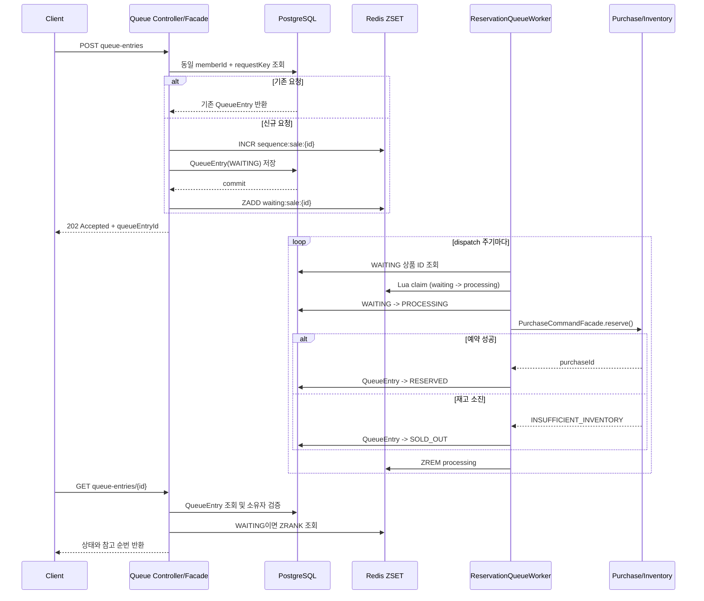

# Limited Ticketing 아키텍처

## 1. 시스템 개요

Limited Ticketing은 한정 수량 상품의 판매, 재고 예약, 구매, 결제 시도와 대기열 진입을 다루는 **모듈러 모놀리스**다. 현재 모든 모듈은 하나의 Spring Boot 애플리케이션으로 실행하고 하나의 컨테이너 또는 Pod로 배포한다.

```text
member + sale + inventory + purchase + payment + queue
                            |
                         app.jar
                            |
                   Container 또는 Pod 하나
```

Gradle 하위 프로젝트와 Spring Modulith 애플리케이션 모듈은 배포 단위가 아니다. 모듈은 코드 소유권과 의존 방향을 강제하기 위한 경계이며, 독립 배포가 필요한 근거가 생길 때만 서비스 분리를 검토한다.

### 핵심 원칙

- PostgreSQL은 구매, 재고, 대기열 상태의 최종 정합성 기준이다.
- Redis는 대기 순서와 처리 슬롯을 제어하는 보조 저장소다. 재고 수량과 구매 확정 상태를 Redis에 두지 않는다.
- 각 도메인은 자기 모델과 Repository를 소유한다. 다른 도메인은 공개 Facade와 DTO만 사용한다.
- HTTP 계약, 모듈 공개 계약, 내부 유스케이스 DTO를 분리한다.
- 비동기 처리로 바꿔도 구매 멱등성 및 재고의 조건부 원자 갱신을 최종 보호 장치로 유지한다.

## 2. 프로젝트와 모듈 구성

```text
limited-ticketing
├── app          # Spring Boot 조립, 환경 설정, 전역 HTTP/보안 처리, 통합 테스트
├── shared       # 제한된 공통 값 타입, 공통 예외, 공통 API 응답 계약
├── member       # 회원과 구매 가능 상태
├── sale         # 상품, 판매 기간, 판매 상태
├── inventory    # 가용/예약/판매 재고 전이
├── purchase     # 구매 예약, 취소, 만료, 구매 완료
├── payment      # 결제 시도 이력과 승인/실패
└── queue        # Redis 대기열, 비동기 예약 처리와 상태 조회
```

| 모듈 | 주요 모델 | 책임 | 공개 API를 사용하는 모듈 |
|---|---|---|---|
| `shared` | `Money`, `SalePeriod`, `DomainException`, `ApiResponse` | 전 모듈에서 동일한 의미를 갖는 계약 | 전체 |
| `member` | `Member`, `MemberStatus` | 회원 식별, 구매 가능 여부 | `purchase`, `queue` |
| `sale` | `Product`, `SaleProduct`, `SaleStatus` | 판매 상품, 기간, 판매 상태와 구매 가능 여부 | `purchase`, `queue` |
| `inventory` | `Inventory` | 가용, 예약, 판매 수량의 원자적 전이 | `sale`, `purchase`, `payment` |
| `purchase` | `Purchase`, `PurchaseStatus` | 구매 예약, 취소, 만료, 완료와 구매 멱등성 | `payment`, `queue` |
| `payment` | `Payment`, `PaymentStatus` | 결제 시도 이력과 승인/실패 처리 | HTTP API |
| `queue` | `ReservationQueueEntry`, `ReservationQueueStatus` | 대기 순번, 처리 상태, 비동기 예약 결과 | HTTP API |
| `app` | - | 실행 모듈, DataSource/Flyway/Redis/Security/전역 예외 조립 | 전체 |

모듈 간 Aggregate 참조는 객체 그래프가 아니라 식별자로 표현한다. 예를 들어 `Purchase`는 `memberId`, `saleProductId`만 보관하며 `Member`, `SaleProduct` 엔티티를 직접 참조하지 않는다.

## 3. 모듈 경계와 의존 규칙

Gradle 의존성은 컴파일 가능 여부를, Spring Modulith의 `@ApplicationModule`은 허용된 모듈 참조 방향을 검증한다. 두 규칙을 모두 만족해야 다른 모듈의 타입을 사용할 수 있다.

```text
shared    -> 없음
member    -> shared::exception
sale      -> shared::vo, shared::exception, shared::api, inventory::api
inventory -> shared::exception
purchase  -> shared::vo, shared::exception, shared::api,
             member::api, sale::api, inventory::api
payment   -> shared::vo, shared::exception, shared::api,
             purchase::api, inventory::api
queue     -> shared::api, shared::exception,
             member::api, sale::api, purchase::api
```

`::api`, `::vo`, `::exception`, `::events`는 Spring Modulith Named Interface다. 모듈 전체가 아니라 필요한 공개 패키지만 노출한다.

```java
@ApplicationModule(allowedDependencies = {
    "shared::vo",
    "member::api",
    "sale::api",
    "inventory::api"
})
package com.example.limitedticketing.purchase;
```

```java
@NamedInterface("api")
package com.example.limitedticketing.member.application.port.in;
```

다른 모듈을 호출할 때는 대상 모듈의 `application.port.in` Facade와 `application.port.in.dto`만 참조한다. 대상 모듈의 Domain 모델, JPA Entity, Spring Data Repository, 내부 Command/Query Service는 직접 참조하지 않는다.

## 4. 레이어 구조

모든 도메인 모듈은 아래 구조를 기본으로 사용한다. 필요한 코드가 없으면 패키지를 미리 만들지 않는다.

```text
purchase
├── presentation                         # HTTP 어댑터
│   ├── controller
│   ├── request
│   └── response
├── application                          # 유스케이스와 트랜잭션 경계
│   ├── command
│   │   ├── dto
│   │   └── service
│   ├── query
│   │   ├── dto
│   │   └── service
│   ├── support                           # Finder 등 유스케이스 공통 보조 객체
│   └── port
│       ├── in                            # 다른 모듈/Controller에 공개하는 Facade
│       │   └── dto
│       └── out                           # 인프라에 요구하는 기술 중립 계약
├── domain                               # 순수 비즈니스 규칙
│   ├── event
│   ├── exception
│   ├── model
│   └── repository
└── infrastructure                       # JPA, Redis, Spring Event 등의 구현체
    ├── configuration
    ├── messaging
    ├── persistence
    │   ├── entity
    │   └── repository
    └── redis
```

### 레이어 책임

| 레이어 | 책임 | 허용되는 의존성 |
|---|---|---|
| `presentation` | HTTP 바인딩, 인증 주체 추출, HTTP 응답 생성 | 공개 `port.in`과 HTTP DTO |
| `application.command` | 상태 변경 유스케이스, 트랜잭션, 도메인 조율 | Domain, 다른 모듈의 공개 API, `port.out` |
| `application.query` | 상태를 바꾸지 않는 조회 유스케이스 | Domain Repository, 조회용 `port.out` |
| `application.port.in` | 모듈 외부 진입점, 공개 DTO와 내부 DTO 변환 | 내부 Application Service |
| `application.port.out` | DB 외 기술에 대한 요구 계약 | 기술 중립 인터페이스만 선언 |
| `domain` | 상태 전이, 불변식, 도메인 예외, Repository 추상화 | Java와 `shared`의 의미 있는 값 타입 |
| `infrastructure` | JPA, Spring Data, Redis, Spring Event, Scheduler 구현 | Domain Repository 및 `port.out` 구현 |

Domain에는 Spring, JPA, Hibernate 어노테이션을 두지 않는다. JPA 매핑은 `infrastructure.persistence.entity`의 `*JpaEntity`가 소유하고, `*RepositoryAdapter`가 JPA Entity와 Domain 모델을 변환하면서 Domain Repository를 구현한다.

### 호출 흐름

```text
HTTP 요청
  -> presentation.request
  -> application.port.in.dto
  -> application.port.in.*Facade
  -> application.command/query.dto
  -> application.command/query.service
  -> domain model / domain repository
  -> infrastructure adapter / JPA entity
  -> presentation.response

다른 모듈 호출
  -> 대상 모듈 application.port.in.dto
  -> 대상 모듈 application.port.in.*Facade

외부 기술 호출
  -> application service
  -> application.port.out
  -> infrastructure 구현체
```

`Facade`는 공개 계약을 내부 Command/Query로 변환하고 Service에 위임한다. 비즈니스 규칙과 트랜잭션은 Facade가 아니라 Application Service와 Domain에 둔다. `port.out`은 다른 모듈에서 호출하는 API가 아니라, Application이 인프라 구현에 의존하지 않게 하는 출력 포트다.

## 5. DTO, 예외, 시간 규칙

### DTO 경계

| 위치 | 역할 | 이름 예시 |
|---|---|---|
| `presentation.request` | HTTP 입력 및 Bean Validation | `ReservePurchaseRequest` |
| `presentation.response` | HTTP JSON 응답 | `PurchaseReservationResponse` |
| `shared.api` | 성공 응답 외피 | `ApiResponse<T>` |
| `application.command.dto` | 내부 상태 변경 입력/결과 | `ReservePurchaseCommand`, `PurchaseReservationResult` |
| `application.query.dto` | 내부 조회 입력/결과 | `FindPurchaseQuery`, `PurchaseDetailResult` |
| `application.port.in.dto` | 모듈 공개 Facade 계약 | `ReservePurchaseInput`, `PurchaseReservation` |
| `application.port.out` | 외부 기술 호출 계약 | `PurchaseEventPublisher`, `ReservationQueueStore` |

`presentation`과 `application.port.in.dto`는 Domain Aggregate, Repository, Domain enum, 내부 Command/Query/Support DTO를 직접 import하지 않는다. 공개 상태값은 `String` 또는 공개 계약 enum으로 표현하고, Facade에서 Domain enum으로 변환한다.

단순 DTO 변환은 대상 DTO의 `from(source)` 또는 `of(...)` 정적 팩토리에 둔다. Aggregate를 필수 조회하는 공통 규칙은 `application.support.*Finder`로 분리하며, 각 Service에 같은 `findById(...).orElseThrow(...)`를 반복하지 않는다.

### 예외와 HTTP 응답

각 도메인은 `PurchaseException`, `PaymentException`, `InventoryException`처럼 도메인별 예외를 던진다. 이 예외는 `shared.exception.DomainException`을 상속하며 `INVALID_REQUEST`, `NOT_FOUND`, `CONFLICT`, `FORBIDDEN` 분류와 오류 코드를 가진다.

`app`의 `GlobalExceptionHandler`가 이를 HTTP 상태와 `ApiErrorResponse`로 변환한다. 성공 응답은 `ApiResponse.success(data)`를 기본으로 사용한다. 생성 API처럼 `201 Created` 또는 `202 Accepted`와 `Location` 헤더가 필요한 경우에는 `ResponseEntity<ApiResponse<T>>`를 사용한다.

### 시간

기술적으로 동일한 현재 시각은 `app.configuration.time.TimeConfiguration`이 제공하는 JDK `Clock` Bean을 주입받아 사용한다. 테스트는 `Clock.fixed(...)`로 시간을 고정한다. 영업일, 정산 마감처럼 도메인별 시간 정책이 생길 때만 별도 Port를 만든다.

## 6. 영속성, 정합성, 이벤트

### PostgreSQL과 Flyway

PostgreSQL이 최종 영속 저장소다. `app`이 DataSource, Flyway, JPA 설정을 소유하고 모든 도메인 모듈은 같은 DataSource를 공유한다.

- Flyway migration이 스키마 변경의 유일한 이력이다.
- 적용된 migration 파일은 수정하지 않고 변경마다 다음 버전의 SQL 파일을 추가한다.
- Hibernate는 `ddl-auto: validate`로 Entity와 스키마의 불일치만 검증한다.
- H2 대신 Testcontainers PostgreSQL로 통합 테스트를 수행한다.
- Aggregate 간 참조는 Domain 모델에서 식별자로 표현하되, 단일 DB 안의 물리 참조는 FK로 보호한다.
- FK 삭제 정책은 `RESTRICT`를 사용하며 Aggregate를 연쇄 삭제하지 않는다.

구매와 결제의 멱등성은 DB 유니크 제약과 기존 행 재조회로 보장한다.

```text
purchases(member_id, purchase_request_key)  # 동일 구매 요청 재시도
payments(payment_request_key)                # 동일 결제 시도 재시도
reservation_queue_entries(member_id, purchase_request_key)
                                                # 동일 대기열 진입 재시도
```

활성 구매와 활성 대기열 항목은 별도 제약으로 막는다. 구매는 `active_purchase_key`를 사용하고, 대기열은 `WAITING`, `PROCESSING` 상태에만 적용되는 `(member_id, sale_product_id)` 부분 유니크 인덱스를 사용한다.

재고 예약은 조회 후 저장 방식이 아니라 조건부 원자 UPDATE로 수행한다. `available_quantity >= 요청 수량`일 때만 `available`을 줄이고 `reserved`를 늘린다. 영향 행 수가 0이면 재고 부족으로 처리하므로 동시 요청에서도 음수 재고와 유실 갱신을 방지한다.

### 도메인 이벤트

상태 변경 후 같은 프로세스 안에서 후속 작업을 수행할 때 Spring Modulith 이벤트를 사용한다. `purchase.domain.event`는 `events` Named Interface로 공개된다.

```text
Aggregate 상태 변경
  -> Application Service가 저장
  -> 트랜잭션 커밋 후 Spring 이벤트 발행
  -> 다른 모듈의 구독 처리
```

프로세스 내부 이벤트는 외부 메시지 브로커가 아니다. 프로세스 종료에도 반드시 전달되어야 하는 이벤트, 소비자 독립 확장, 재시도와 모니터링이 필요해지면 Transactional Outbox와 Kafka를 별도 단계로 도입한다.

## 7. Redis ZSET 대기열

### 목적과 경계

판매 오픈 직후 모든 요청을 PostgreSQL 재고 행으로 바로 보내지 않기 위해 Redis Sorted Set(ZSET)으로 상품별 대기 순서와 처리 중 요청 수를 제어한다.

- Redis: 순번, 대기열 위치, 처리 슬롯
- PostgreSQL: 대기열 항목의 영속 상태, 멱등성, 구매/재고의 최종 정합성
- Purchase/Inventory: 실제 구매 예약과 재고 차감의 최종 보호 장치

직접 예약 API는 성능 기준선 비교를 위해 유지한다. 대기열 API를 호출한 요청만 ZSET 대기열을 거쳐 비동기 예약된다.

```text
직접 예약
POST /api/sale-products/{saleProductId}/purchases
  -> PurchaseCommandFacade.reserve()
  -> 즉시 구매/재고 DB 처리

대기열 예약
POST /api/sale-products/{saleProductId}/queue-entries
  -> QueueEntry 생성
  -> Redis 대기열 진입
  -> 백그라운드 Worker가 순번대로 구매 예약 처리
```

`queue-entries`는 Redis라는 구현 기술을 드러내는 이름이 아니라, 사용자가 생성하는 **대기열 항목**이라는 도메인 개념이다. Redis를 Kafka나 Redis Streams로 바꿔도 `ReservationQueueEntry`의 상태 조회와 멱등성 계약은 유지한다.

### Redis 키와 DB 상태

```text
waiting:sale:{saleProductId}      # ZSET, score=queueSequence, member=queueEntryId
processing:sale:{saleProductId}   # ZSET, score=claim timestamp, member=queueEntryId
sequence:sale:{saleProductId}     # String, Redis INCR로 순번 생성
```

```text
reservation_queue_entries
- id (UUID)
- member_id
- sale_product_id
- purchase_request_key
- queue_sequence
- status: WAITING | PROCESSING | RESERVED | SOLD_OUT | FAILED
- purchase_id, failure_code
- created_at, processing_started_at, completed_at
```

UUID는 DB 저장 전에도 Redis member와 DB 행에서 동일한 식별자가 필요하므로 사용한다. 대기 순번은 서버 시간이 아니라 Redis `INCR` 값으로 만든다. 같은 밀리초의 요청에도 순서를 부여할 수 있다.

### 처리 흐름



`ReservationQueueWorker`는 HTTP 요청 스레드와 별도로 실행되는 Spring 백그라운드 작업자다. 현재는 `@Scheduled`로 항목을 claim하고 `reservationQueueTaskExecutor`에 구매 처리 작업을 제출한다. Lua 스크립트가 처리 중인 ZSET 수를 확인하고 남은 슬롯만큼 `waiting`에서 `processing`으로 이동시키므로, 같은 상품의 DB 예약 경로 동시 진입 수를 제한한다.

### 현재 설정

`app/src/main/resources/application.yml`에서 환경 변수로 조정한다.

| 설정 | 기본값 | 의미 |
|---|---:|---|
| `QUEUE_MAX_CONCURRENT_PROCESSING` | `10` | 상품별 Redis processing ZSET에 claim할 최대 항목 수 |
| `QUEUE_CLAIM_BATCH_SIZE` | `10` | 한 Lua claim 호출에서 가져올 최대 항목 수 |
| `QUEUE_WORKER_FIXED_DELAY` | `100ms` | 대기열 dispatch 작업 주기 |
| `QUEUE_WORKER_INITIAL_DELAY` | `1000ms` | 애플리케이션 시작 후 첫 dispatch 지연 |
| `QUEUE_RECOVERY_FIXED_DELAY` | `5000ms` | Redis/DB 불일치 및 stale processing 복구 주기 |
| `QUEUE_RECOVERY_INITIAL_DELAY` | `5000ms` | 첫 복구 작업 지연 |
| `QUEUE_PROCESSING_TIMEOUT_SECONDS` | `30초` | PROCESSING 항목을 stale로 판단하는 시간 |

TaskExecutor의 최대 스레드 수는 현재 `QUEUE_MAX_CONCURRENT_PROCESSING`과 같은 값이다. 단일 판매 상품에서는 Redis 슬롯과 실제 실행 수가 일치한다. 여러 상품이 동시에 열리면 Redis 슬롯은 상품별로 계산되지만 TaskExecutor는 애플리케이션 전체에서 공유되므로, 상품 간 공정성이나 전역 처리량 제한이 필요해지는 시점에 별도 정책을 추가한다.

### 장애와 복구

- DB 커밋 후 Redis `ZADD`가 실패하면 `WAITING` DB 행은 남는다. 복구 작업이 다시 ZSET에 적재한다.
- Redis claim 이후 프로세스가 중단되면 `PROCESSING` 항목은 timeout 이후 `WAITING`으로 되돌린다.
- 구매 DB 트랜잭션이 성공하고 QueueEntry 완료 처리 전에 중단돼도, 구매 요청 키의 멱등성이 중복 구매를 막고 이후 재처리를 허용한다.
- Redis는 보조 저장소이므로 Redis 항목 유실은 보통 영구 요청 유실이 아니라 복구 전까지의 처리 지연이다.

현재 Compose의 Redis는 로컬 개발용이며 AOF, replica, 영속 볼륨을 설정하지 않는다. Redis 컨테이너 재생성 시 ZSET과 sequence가 초기화될 수 있다. DB 대기열은 복구되지만 대기 순서가 섞일 수 있으므로, 운영에서 순번 보존이 중요하면 Redis 영속화와 고가용성 구성을 추가해야 한다.

## 8. 메시지 큐로의 확장 기준

현재는 하나의 애플리케이션 안에서 Spring TaskExecutor가 비동기 작업을 처리한다. Kafka나 Redis Streams는 아직 구현하지 않았다.

다음 요구가 실제로 생길 때 Kafka를 검토한다.

- 구매 처리 워커를 API 애플리케이션과 독립 배포해야 한다.
- 여러 워커 인스턴스에서 작업을 분산해야 한다.
- 작업 전달의 재시도, 소비 지연, 소비자별 처리량을 브로커 차원에서 관찰해야 한다.
- 구매 완료 이벤트를 여러 독립 서비스에 전달해야 한다.

Kafka를 도입하면 ZSET과 `QueueEntry`를 함께 유지한다. ZSET은 사용자 대기 순번, `QueueEntry`는 상태 조회와 멱등성, Kafka는 입장 허용된 작업의 전달을 담당한다.

```text
ZSET 대기열 입장 허용
  -> QueueEntry: WAITING -> PROCESSING
  -> 같은 DB 트랜잭션에서 Outbox 이벤트 저장
  -> Outbox Publisher가 Kafka Producer로 발행
  -> Kafka Consumer가 구매 예약 처리
  -> QueueEntry: RESERVED / SOLD_OUT
  -> 처리 성공 뒤 offset commit
```

이 단계에서는 현재 `reservationQueueTaskExecutor`와 Worker의 구매 처리 부분이 Kafka Consumer로 대체된다. ZSET에서 순번을 꺼내 Outbox를 만드는 admission dispatcher와 DB/Redis 복구 작업은 남는다. DB 상태 변경과 Kafka 발행을 직접 연달아 호출하면 중간 장애에서 작업이 유실될 수 있으므로 Outbox 없이 Kafka를 붙이지 않는다.

## 9. 실행 환경과 검증

### 로컬 실행

```bash
cp .env.example .env
docker compose up -d
./gradlew :app:bootRun
```

기본 연결 값은 다음과 같다.

```text
PostgreSQL: localhost:5432 / limited_ticketing
Redis:      localhost:6379
Application: localhost:8081
```

`spring.data.redis.repositories.enabled=false`는 Spring Data Redis Repository 자동 구성을 끄는 설정이다. `StringRedisTemplate` 기반의 ZSET 사용을 끄는 설정이 아니다.

로컬 및 테스트 프로필에서는 `X-Member-Id`, `X-Admin-Id`를 임시 인증 수단으로 사용한다. 운영 환경에는 개발용 인증 필터가 등록되지 않으므로 실제 인증/인가 방식을 별도로 구성해야 한다.

### 자동 검증

```bash
./gradlew test
```

| 검증 | 목적 |
|---|---|
| `ModularityTests` | Named Interface 외부 접근, 금지된 모듈 참조, 순환 의존 검증 |
| `LayeringArchitectureTests` | Domain의 Spring/JPA 의존, Application의 Infrastructure 직접 의존, 공개 DTO의 Domain/내부 DTO 노출 검증 |
| `PurchaseConcurrencyIntegrationTest` | 동시 예약에서 정확한 재고 수량과 활성 구매 제약 검증 |
| `PurchaseReservationIntegrationTest` | 구매 예약과 구매 멱등성 검증 |
| `PaymentLifecycleIntegrationTest` | 결제 실패/재시도/승인/취소에 따른 구매와 재고 전이 검증 |
| `SaleProductManagementIntegrationTest` | 판매 생성, 상태 전이, 재고 생성, 목록/상세 조회 검증 |
| `ReservationQueueIntegrationTest` | Redis ZSET과 PostgreSQL에서 대기열 멱등성, 중복 차단, 예약/품절, 복구 검증 |

`ModularityDocumentationTests`는 Spring Modulith `Documenter`로 코드 기준의 모듈 문서를 생성한다.

```text
app/build/spring-modulith-docs/
├── components.puml
├── module-*.puml
├── module-*.adoc
└── all-docs.adoc
```

새 모듈, Named Interface, 모듈 간 의존성을 변경할 때는 `./gradlew test`를 실행해 아키텍처 검증과 모듈 문서 생성을 함께 갱신한다. Redis 대기열의 세부 선택 근거와 단계별 부하 검증 계획은 [WAITING_ROOM_SPEC.md](WAITING_ROOM_SPEC.md)에 기록한다.
