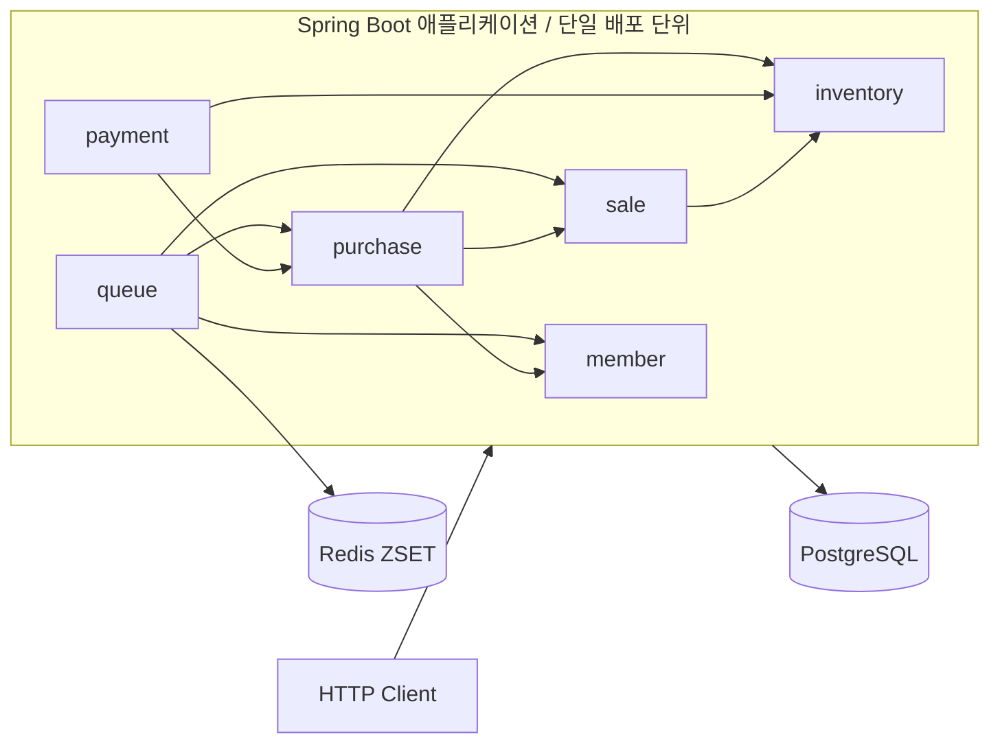
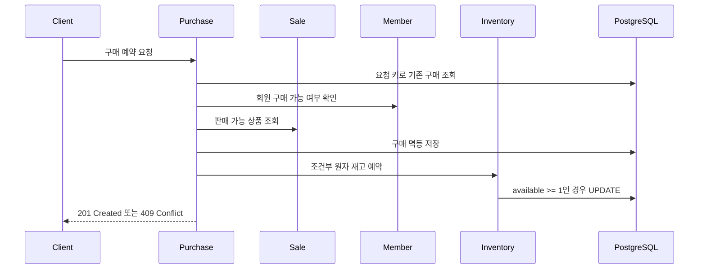
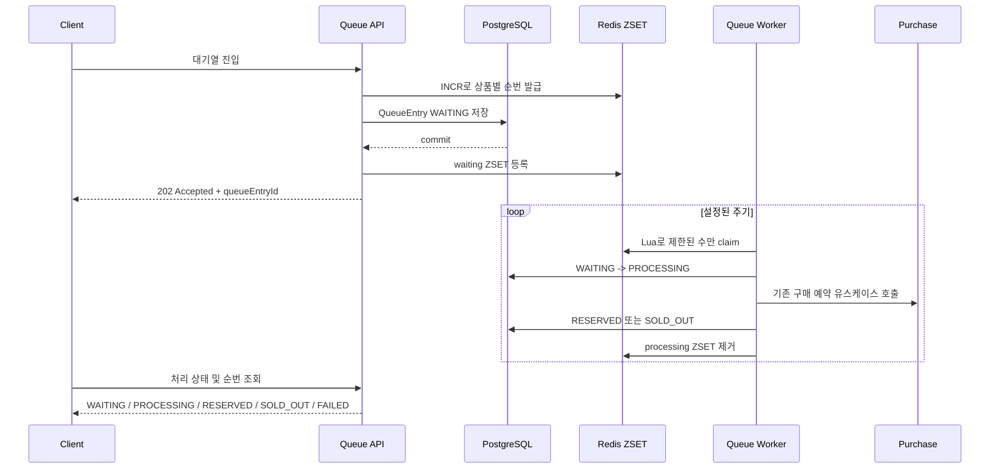

# Limited Ticketing

한정 수량 상품을 사용자당 1개까지 예약하고 결제하는 과정을 구현하는 프로젝트입니다. 판매 시작 시점의 동시 요청을 안전하게 처리하고, 측정된 병목을 근거로 기술을 점진적으로 도입하는 것을 목표로 합니다.

현재는 **Spring Modulith 기반 모듈러 모놀리스**로 구성되어 있으며, 모든 도메인 모듈이 하나의 Spring Boot 애플리케이션과 PostgreSQL 데이터베이스를 공유합니다. Redis ZSET은 대기 순서와 DB 진입 동시성만 제어하고, 구매 및 재고의 최종 정합성은 PostgreSQL이 보장합니다.

## 주요 기능

- 판매 상품 생성과 판매 기간 설정
- 판매 상태 전이: `DRAFT -> OPEN -> CLOSED`
- 사용자당 판매 상품 1개 구매 제한
- 결제 대기 구매 예약과 취소 및 만료
- 구매별 복수 결제 시도와 결제 멱등성
- 조건부 원자 갱신을 이용한 동시 재고 예약
- Redis ZSET 기반 상품별 대기열과 비동기 예약 처리
- DB와 Redis 불일치 및 중단된 처리 항목 복구
- Spring Modulith를 이용한 모듈 경계 검증 및 문서 생성
- Testcontainers PostgreSQL/Redis 기반 통합 및 동시성 테스트
- k6 기반 판매 오픈 부하 테스트

## 아키텍처



Gradle 하위 프로젝트는 코드 소유권과 의존 방향을 구분하지만 각각의 배포 단위는 아닙니다. 현재 `app` 모듈이 모든 도메인 모듈을 조립하고 하나의 실행 파일로 배포됩니다. 독립적인 확장 및 배포가 필요하다는 근거가 생길 때만 서비스 분리를 검토합니다.

### 모듈 구성

```text
limited-ticketing
├── app          # 애플리케이션 실행, 전역 설정, 보안, 예외 처리, 통합 테스트
├── shared       # 공통 값 타입, 예외 기반 클래스, API 응답 계약
├── member       # 회원 식별과 구매 가능 상태
├── sale         # 상품, 판매 기간, 판매 상태
├── inventory    # 가용/예약/판매 재고 전이
├── purchase     # 구매 예약, 취소, 만료, 완료
├── payment      # 결제 시도 이력과 승인/실패
└── queue        # Redis 대기열, 비동기 예약과 처리 상태
```

다른 모듈은 대상 모듈의 `application.port.in`에 공개된 Facade와 DTO만 사용합니다. Spring Modulith의 `@ApplicationModule(allowedDependencies = ...)`과 `@NamedInterface`로 허용된 참조를 명시하고 테스트에서 순환 의존 및 내부 구현 접근을 검증합니다.

### 레이어 구성

```text
domain-module
├── presentation
│   ├── controller
│   ├── request
│   └── response
├── application
│   ├── command
│   │   ├── dto
│   │   └── service
│   ├── query
│   │   ├── dto
│   │   └── service
│   ├── support
│   └── port
│       ├── in
│       │   └── dto
│       └── out
├── domain
│   ├── event
│   ├── exception
│   ├── model
│   └── repository
└── infrastructure
    ├── configuration
    ├── messaging
    ├── persistence
    │   ├── entity
    │   └── repository
    └── redis
```

- `presentation`: HTTP 요청 및 응답과 인증 주체를 다룹니다.
- `application`: 유스케이스 실행, 트랜잭션 경계와 모듈 간 조율을 담당합니다.
- `domain`: 프레임워크와 분리된 상태 전이, 불변식, 도메인 예외를 소유합니다.
- `infrastructure`: JPA, Redis, Spring Event, Scheduler 등 기술 구현을 제공합니다.
- `port.in`: Controller와 다른 모듈에 공개하는 입력 계약입니다.
- `port.out`: Application이 DB 외부 기술에 요구하는 출력 계약입니다.

JPA Entity는 Domain 모델과 분리합니다. `infrastructure.persistence`의 Repository Adapter가 Domain Repository를 구현하고 Domain 모델과 JPA Entity 간 변환을 담당합니다.

## 핵심 처리 흐름

### 직접 구매 예약

직접 예약 API는 동시성 제어 방식의 기준선을 측정하기 위해 유지합니다.



재고는 조회 후 값을 덮어쓰지 않고 `available_quantity >= quantity` 조건이 포함된 원자 UPDATE로 변경합니다. 구매 요청 키와 활성 구매 키의 DB 제약이 동일 요청 및 사용자 중복 구매를 최종 방어합니다.

### Redis 대기열 예약

대기열 API를 호출한 요청만 Redis ZSET과 백그라운드 Worker를 거칩니다.



Redis는 대기 순서와 처리 슬롯을 담당하는 보조 저장소입니다. `reservation_queue_entries`가 요청 상태와 멱등성을 영속화하며, Redis 등록 실패나 오래된 `PROCESSING` 상태는 DB 기준 복구 작업으로 다시 처리합니다.

## 비즈니스 규칙

- 활성 회원만 구매할 수 있습니다.
- `OPEN` 상태이며 판매 기간 안에 있는 상품만 예약할 수 있습니다.
- 한 사용자는 같은 판매 상품에 `PENDING_PAYMENT` 구매를 동시에 하나만 가질 수 있습니다.
- `PAID` 구매가 있으면 같은 판매 상품을 다시 구매할 수 없습니다.
- `EXPIRED` 또는 `CANCELLED` 이후에는 다시 예약할 수 있습니다.
- 재고 예약 시 `available`이 감소하고 `reserved`가 증가합니다.
- 결제 승인 시 `reserved`가 감소하고 `sold`가 증가합니다.
- 결제 실패는 하나의 결제 시도 이력으로 남으며 구매 예약 만료 전까지 새 요청 키로 재시도할 수 있습니다.
- 구매 취소 또는 만료 시 예약 재고가 가용 재고로 반환됩니다.

## 이벤트와 향후 메시징 확장

구매 예약 성공 시 `PurchaseReserved`를 트랜잭션 커밋 후 Spring 이벤트로 발행합니다. 현재 운영 코드에는 이 이벤트를 소비하는 후처리 Listener가 없으며, 테스트에서 발행 여부만 검증합니다.

현재 Kafka, Transactional Outbox, Saga는 구현하지 않았습니다. 다음 요구가 확인될 때 단계적으로 도입합니다.

1. 같은 프로세스의 비핵심 후처리는 Spring Event Listener로 구현합니다.
2. 프로세스 종료에도 이벤트 전달이 보장되어야 하면 Outbox를 추가합니다.
3. 워커 독립 배포, 다중 Consumer, 재처리 및 처리량 확장이 필요하면 Outbox와 Kafka를 함께 도입합니다.
4. 서로 다른 서비스와 데이터베이스에 걸친 상태 변경 및 보상 트랜잭션이 필요할 때만 Saga를 검토합니다.

현재 모듈러 모놀리스의 단일 DB 트랜잭션으로 해결할 수 있는 흐름에는 Saga를 사용하지 않습니다.

## 기술 스택

| 구분 | 기술 |
|---|---|
| Language | Java 17 |
| Framework | Spring Boot 3.5, Spring Modulith 1.4 |
| Persistence | Spring Data JPA, PostgreSQL 17, Flyway |
| Queue | Redis 7, ZSET, Lua Script, Spring TaskExecutor |
| Security | Spring Security, 로컬 테스트용 Header 인증 |
| Test | JUnit 5, Spring Boot Test, Testcontainers, Spring Modulith Test |
| Load Test | k6 |
| Build | Gradle Multi-Project Build |

## 로컬 실행

### 요구 사항

- JDK 17
- Docker 및 Docker Compose

### PostgreSQL과 Redis 실행

```bash
cp .env.example .env
docker compose up -d
docker compose ps
```

기본 연결 정보는 다음과 같습니다.

| 대상 | 기본값 |
|---|---|
| Application | `http://localhost:8081` |
| PostgreSQL | `localhost:5432/limited_ticketing` |
| Redis | `localhost:6379` |

### 애플리케이션 실행

```bash
SPRING_PROFILES_ACTIVE=local ./gradlew :app:bootRun
```

Flyway가 시작 시 `app/src/main/resources/db/migration`의 스키마를 적용하고 Hibernate는 `ddl-auto=validate`로 매핑 일치 여부만 검사합니다.

로컬 프로필에서는 실제 인증 구현 대신 다음 헤더를 사용합니다.

```text
X-Member-Id: {memberId}
X-Admin-Id: admin
```

이 인증 방식은 `local`, `test` 프로필 전용이며 운영용 인증 수단이 아닙니다.

## 주요 API

| Method | Endpoint | 설명 |
|---|---|---|
| `POST` | `/api/admin/sale-products` | 판매 상품과 초기 재고 생성 |
| `PUT` | `/api/admin/sale-products/{id}/sale-period` | 판매 기간 변경 |
| `POST` | `/api/admin/sale-products/{id}/open` | 판매 시작 |
| `POST` | `/api/admin/sale-products/{id}/close` | 판매 종료 |
| `GET` | `/api/sale-products` | 판매 상품 목록 조회 |
| `GET` | `/api/sale-products/{id}` | 판매 상품 상세 조회 |
| `POST` | `/api/idempotency-keys` | 구매 또는 결제 요청 키 발급 |
| `POST` | `/api/sale-products/{id}/purchases` | 직접 구매 예약 |
| `POST` | `/api/purchases/{id}/cancel` | 구매 예약 취소 |
| `POST` | `/api/purchases/{id}/payments` | 결제 시도 생성 |
| `POST` | `/api/payments/{id}/approve` | 결제 승인 |
| `POST` | `/api/payments/{id}/fail` | 결제 실패 처리 |
| `POST` | `/api/sale-products/{id}/queue-entries` | 대기열 기반 예약 접수 |
| `GET` | `/api/queue-entries/{id}` | 대기 순번 및 처리 상태 조회 |

요청과 응답의 상세 계약은 Controller 코드 및 [대기열 명세](WAITING_ROOM_SPEC.md)를 참고합니다.

## 테스트와 아키텍처 검증

Docker가 실행된 상태에서 전체 테스트를 실행합니다. 통합 테스트는 Testcontainers로 PostgreSQL과 Redis를 구동합니다.

```bash
./gradlew test
```

주요 검증 범위는 다음과 같습니다.

- Domain 상태 전이와 불변식 단위 테스트
- 구매 및 결제 멱등성 통합 테스트
- 재고 동시 예약 및 사용자 중복 요청 테스트
- 판매 생성, 상태 전이와 조회 테스트
- Redis 대기열 진입, 예약, 품절 및 장애 복구 테스트
- Spring Modulith 모듈 의존 방향과 Named Interface 검증
- 레이어별 금지 의존성 검증

Spring Modulith 문서는 테스트 실행 시 다음 경로에 생성됩니다.

```text
app/build/spring-modulith-docs/
```

## 부하 테스트

k6 시나리오는 판매 오픈 직후 동시 예약의 성공 수, 재고 소진 응답, p95 응답 시간과 PostgreSQL 락 대기를 측정합니다.

```bash
k6 run load-test/k6/sale-open.js \
  -e BASE_URL=http://localhost:8081 \
  -e SALE_PRODUCT_ID=1 \
  -e MEMBER_IDS="$MEMBER_IDS" \
  -e VUS=100
```

테스트 데이터 준비, 결과 해석과 DB 락 기록 방법은 [k6 부하 테스트 가이드](load-test/k6/README.md)를 참고합니다. 다음 측정 단계는 Redis 대기열을 1,000명, 5,000명, 10,000명 규모로 검증하고 직접 예약 방식과 비교하는 것입니다.

## 문서

- [ARCHITECTURE.md](ARCHITECTURE.md): 모듈, 레이어, 의존 규칙, 영속성 및 대기열을 포함한 상세 아키텍처
- [WAITING_ROOM_SPEC.md](WAITING_ROOM_SPEC.md): Redis ZSET 대기열 선택 근거, 일관성 정책과 단계별 진행 계획
- [load-test/k6/README.md](load-test/k6/README.md): 직접 예약 부하 테스트 실행 및 결과 해석 방법

## 현재 단계와 로드맵

- [x] 도메인 모델과 모듈 경계 정의
- [x] PostgreSQL/Flyway 기반 영속성 구성
- [x] 구매 및 결제 멱등성 구현
- [x] 조건부 원자 갱신 기반 재고 동시성 제어
- [x] 직접 예약 k6 기준선 측정
- [x] Redis ZSET 대기열과 단일 프로세스 Worker 구현
- [ ] Redis 대기열 부하 테스트 및 직접 예약 방식 비교
- [ ] 상품별 대기 인원 제한, Rate Limit, 운영 지표 추가
- [ ] SSE 또는 WebSocket 기반 대기 상태 알림 검토
- [ ] 필요 시 Transactional Outbox와 Kafka 기반 독립 Worker로 확장
- [ ] 서비스와 DB가 실제로 분리될 때 Saga 검토
