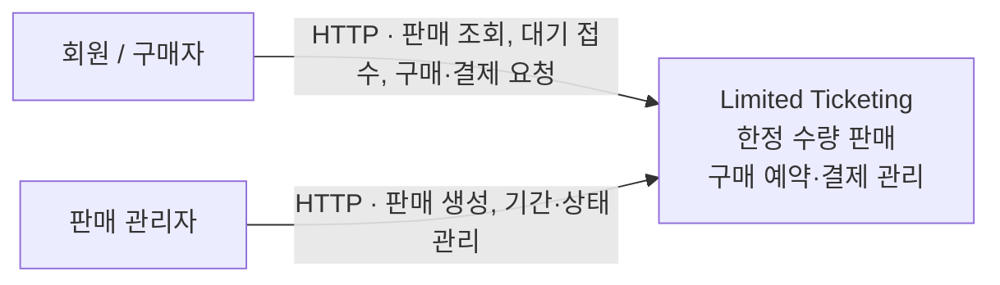
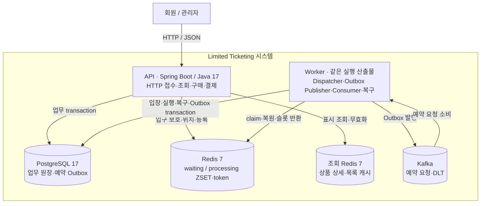

# 시스템 아키텍처

Limited Ticketing은 한정 수량 상품의 판매·구매 예약·결제를 처리하는 **모듈러 모놀리스**다. 업무 모듈은 같은 Spring Boot 애플리케이션 코드와 PostgreSQL을 공유한다. 기본 통합 실행과 API/Worker 역할별 실행을 지원한다. C4는 사용자가 보는 시스템 → 실행 구성 → 필요한 부분의 내부 구성 순으로 설명한다.

## C1 · System Context

현재 구현의 외부 행위자는 회원과 판매 관리자다. 별도 프런트엔드나 결제 공급자 연동은 구현되어 있지 않으며, 결제 승인·실패는 HTTP API로 처리한다. 로컬 인증 계약은 [개발 안내](../development/README.md#로컬-실행)를 따른다.

[System Context](https://c4model.com/diagrams/system-context)는 사용자와 시스템 경계를 설명한다. 이 그림에는 내부 모듈과 저장소를 넣지 않는다.

## C2 · Container

[C4 Container](https://c4model.com/diagrams/container)는 실행 애플리케이션이나 데이터 저장소를 뜻한다. 위 그림은 역할을 나눠 실행할 때의 논리적 구성이다. 기본 실행은 API와 Worker를 한 프로세스에 함께 배치한다. 업무 모듈은 독립 Container가 아니며 두 실행 역할은 같은 코드·DB를 공유한다.

PostgreSQL이 구매·재고·대기 요청의 최종 상태와 Outbox를 소유한다. Redis는 입장 선택과 위치 조회를, Kafka는 입장된 예약 작업의 전달을 담당한다. 전달 보장은 at-least-once이며 DB의 멱등성·token 검사가 업무 중복 효과를 막는다. 선택 이유와 비용은 [ADR 0010](../adr/0010-kafka-reservation-outbox.md)을 따른다.

## 상세 설계와 읽는 순서

| 알고 싶은 내용 | 소유 문서 |
|---|---|
| 코드 모듈·공개 API·계층·DTO·트랜잭션 | [모듈 경계와 내부 설계](module-boundaries.md) |
| 구현 기능과 HTTP·대기·예약·결제·복구의 호출 순서 | [주요 시퀀스](business-flows.md) |
| 실제 로컬 프로세스와 Docker 배치 | [Deployment](deployment.md) |
| 대기 처리 내부 구성·상태·복구 | [구매 대기 설계](purchase-waiting.md#c3--구매-대기-컴포넌트) |
| 표시 캐시·TTL·무효화·DB 업무 판정 분리 | [상품 조회 캐시](product-read-cache.md) |
| 왜 이 구조와 저장소 경계를 선택했는가 | [ADR 목록](../adr/README.md) |
| 실행 방법과 검증 책임 | [개발 안내](../development/README.md), [테스트 기준](../development/testing.md) |
| 앞으로 확장할 조건 | [로드맵](../plans/roadmap.md) |

전체 모듈 관계의 코드 기준 상세 산출물은 `ModularityDocumentationTests`가 생성하는 `app/build/spring-modulith-docs/`를 사용한다. 모든 클래스의 수동 도표를 중복 관리하지 않는다. 이 문서는 [settings.gradle](../../settings.gradle), 모듈 메타데이터, [Compose](../../compose.yaml), [애플리케이션 설정](../../app/src/main/resources/application.yml)을 기준으로 작성했다.
