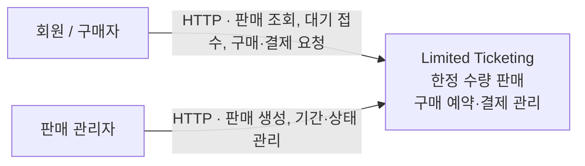
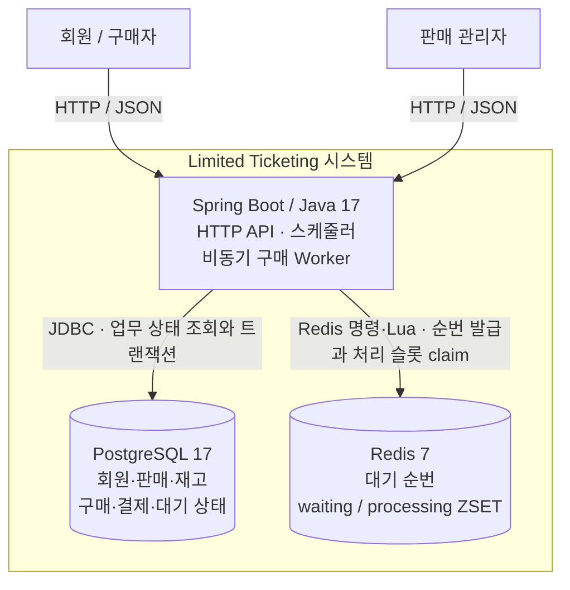

# 시스템 아키텍처

Limited Ticketing은 한정 수량 상품의 판매·구매 예약·결제를 처리하는 **모듈러 모놀리스**다. 업무 모듈은 하나의 Spring Boot 프로세스와 PostgreSQL을 공유한다. C4는 사용자가 보는 시스템 → 실행 구성 → 필요한 부분의 내부 구성 순으로 설명한다.

## C1 · System Context

현재 구현의 외부 행위자는 회원과 판매 관리자다. 별도 프런트엔드나 결제 공급자 연동은 구현되어 있지 않으며, 결제 승인·실패는 HTTP API로 처리한다. 로컬 인증 계약은 [개발 안내](../development/README.md#로컬-실행)를 따른다.

[System Context](https://c4model.com/diagrams/system-context)는 사용자와 시스템 경계를 설명한다. 이 그림에는 내부 모듈과 저장소를 넣지 않는다.

## C2 · Container

[C4 Container](https://c4model.com/diagrams/container)는 실행 애플리케이션이나 데이터 저장소를 뜻한다. `member`, `sale`, `inventory`, `purchase`, `payment`, `purchasewaiting`은 이 애플리케이션 안의 코드 모듈이며 독립 Container가 아니다. Worker도 현재 같은 프로세스에서 실행한다.

PostgreSQL이 구매·재고·대기 요청의 최종 상태를 소유한다. Redis는 처리 시작 순서와 상품별 처리 슬롯을 관리하며, 재고 원장으로 사용하지 않는다. 프로세스 사이의 Kafka 전달이나 Outbox는 아직 구현하지 않았다.

## 상세 설계와 읽는 순서

| 알고 싶은 내용 | 소유 문서 |
|---|---|
| 코드 모듈·공개 API·계층·DTO·트랜잭션 | [모듈 경계와 내부 설계](module-boundaries.md) |
| 실제 로컬 프로세스와 Docker 배치 | [Deployment](deployment.md) |
| 대기 처리 내부 구성·상태·복구 | [구매 대기 설계](purchase-waiting.md#c3--구매-대기-컴포넌트) |
| 왜 이 구조와 저장소 경계를 선택했는가 | [ADR 목록](../adr/README.md) |
| 실행 방법과 검증 책임 | [개발 안내](../development/README.md), [테스트 기준](../development/testing.md) |
| 앞으로 확장할 조건 | [로드맵](../plans/roadmap.md) |

전체 모듈 관계의 코드 기준 상세 산출물은 `ModularityDocumentationTests`가 생성하는 `app/build/spring-modulith-docs/`를 사용한다. 모든 클래스의 수동 도표를 중복 관리하지 않는다. 이 문서는 [settings.gradle](../../settings.gradle), 모듈 메타데이터, [Compose](../../compose.yaml), [애플리케이션 설정](../../app/src/main/resources/application.yml)을 기준으로 작성했다.
