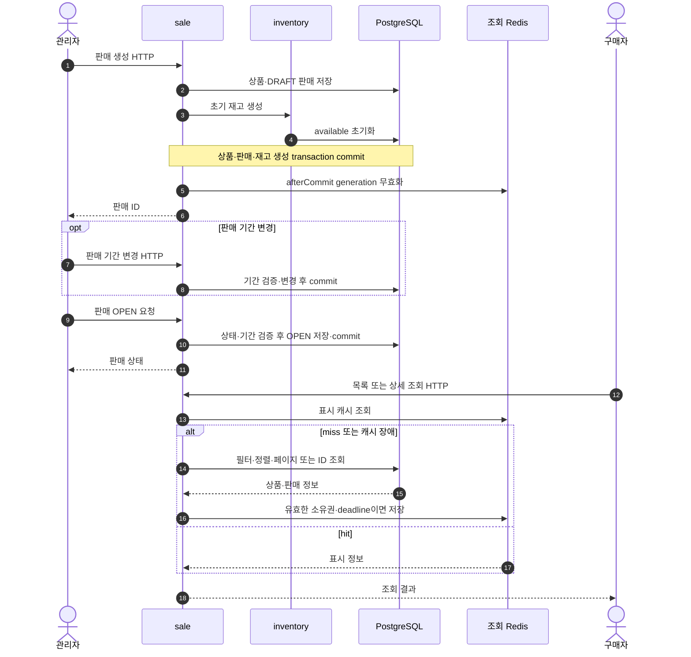
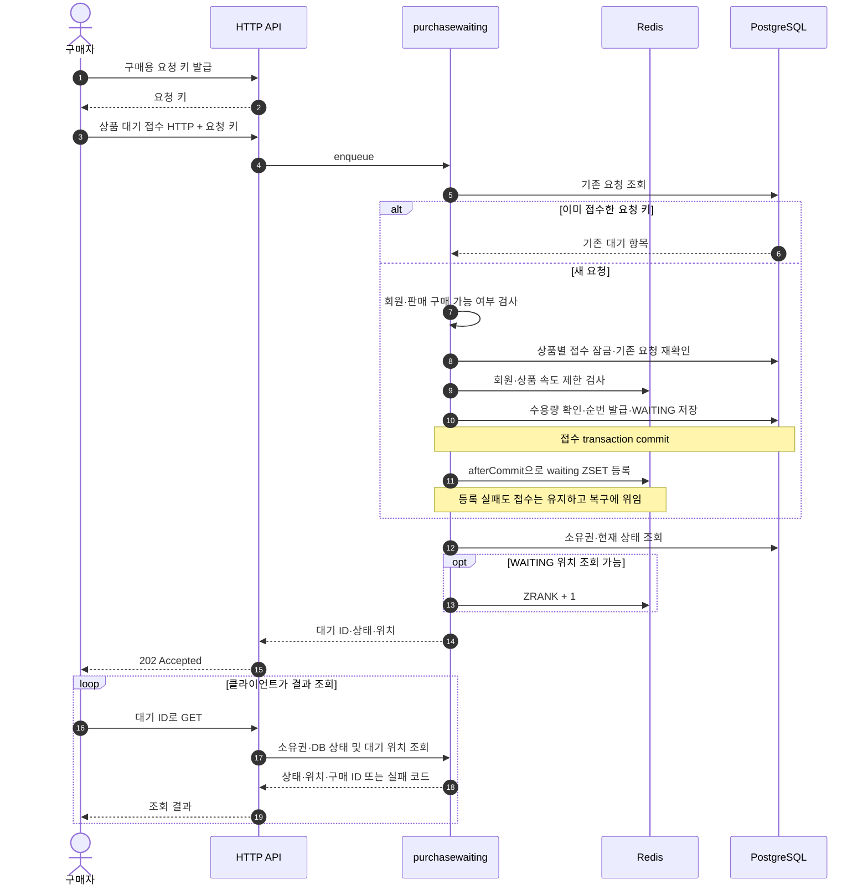
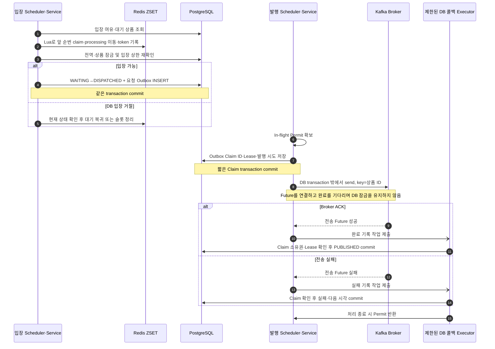
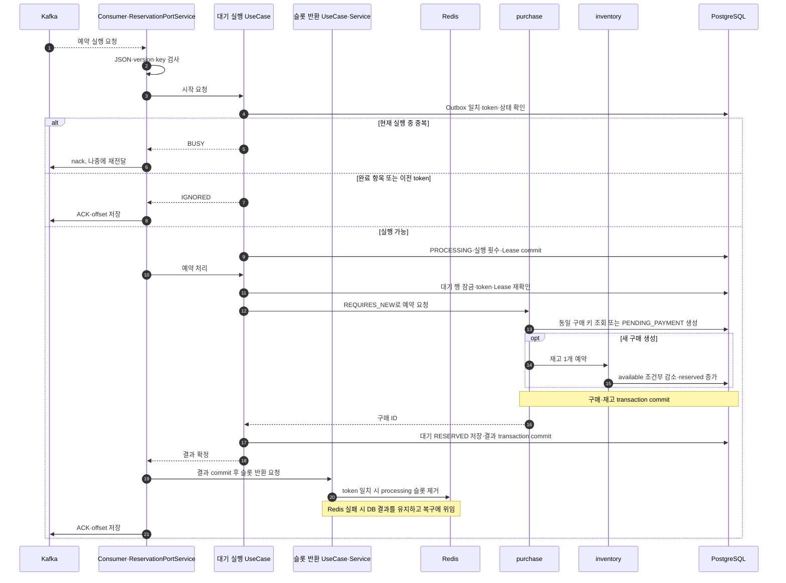
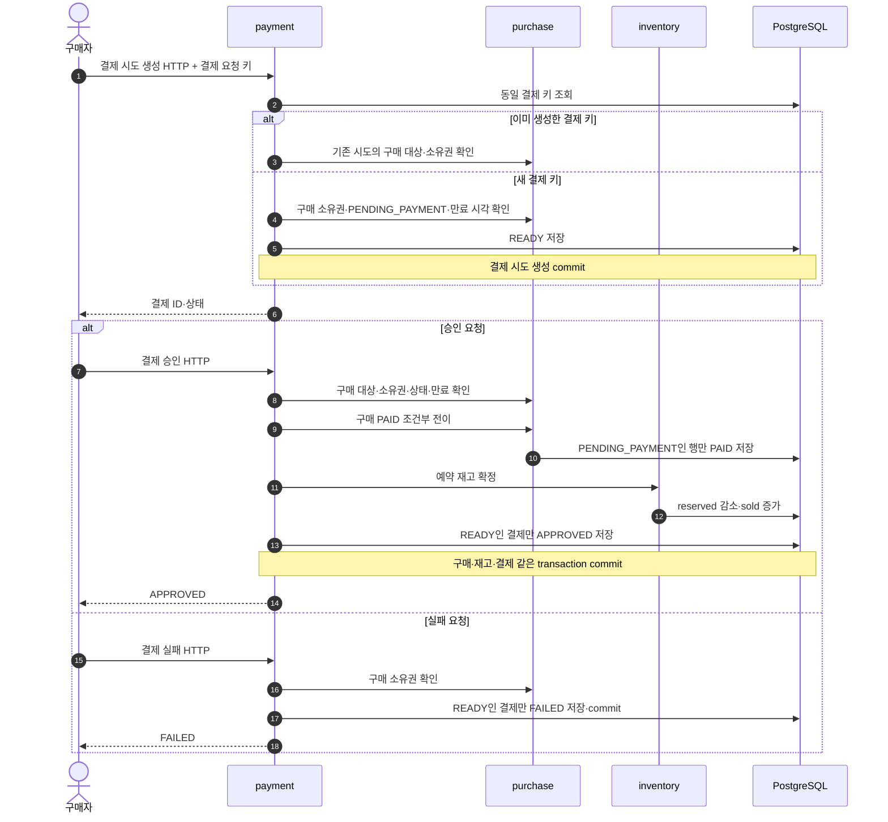
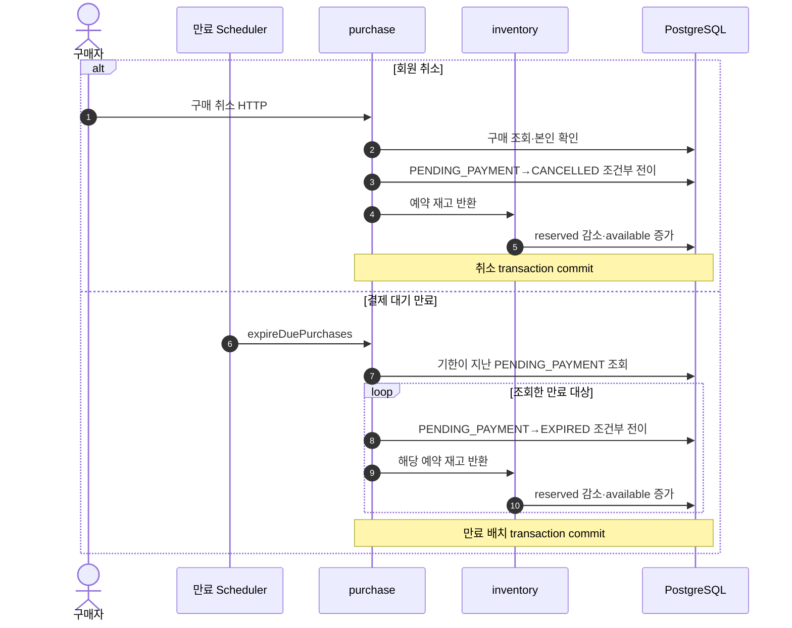
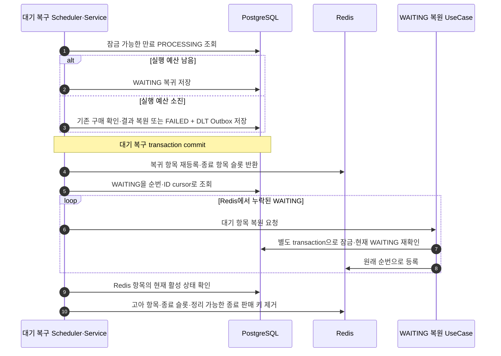
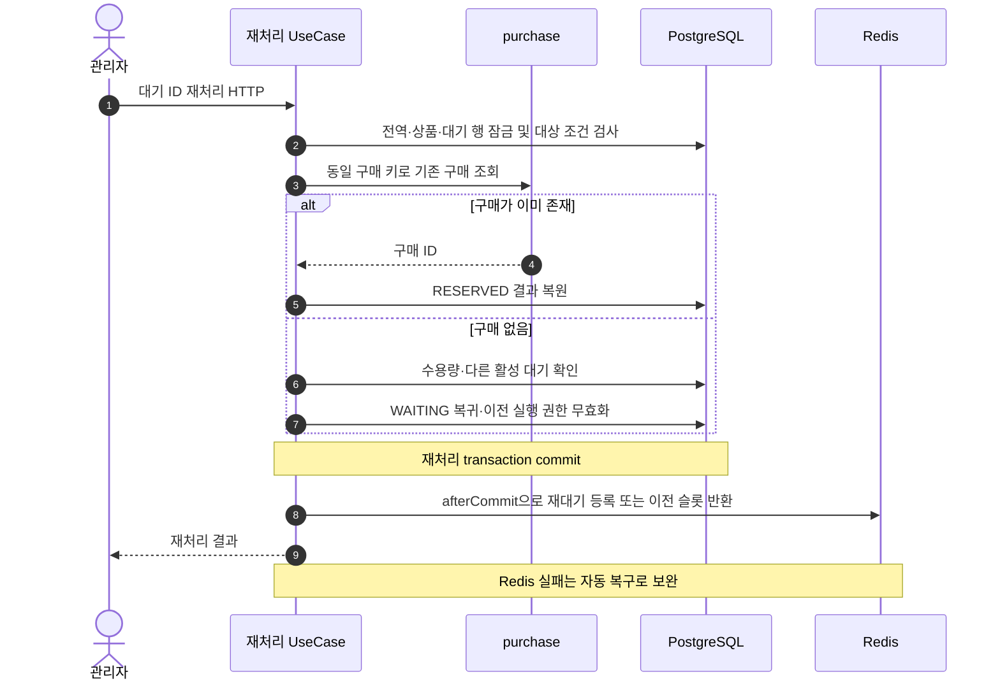

# 구현 기능과 주요 시퀀스

이 문서는 현재 코드의 업무 흐름과 commit·비동기 경계를 설명한다. 구성은 [C4 아키텍처](README.md), 모듈·계층 규칙은 [모듈 설계](module-boundaries.md), 대기 상태·키·복구 조건의 상세 계약은 [구매 대기 설계](purchase-waiting.md)를 따른다. API 목록·실행·설정은 [개발 안내](../development/README.md)가 소유한다.

## 구현 기능과 읽는 순서

| 기능 | 현재 동작 | 관련 흐름 |
|---|---|---|
| 판매 관리·조회 | 상품·판매·초기 재고 생성, 기간·상태 변경, 상세·목록 표시 캐시와 DB 업무 판정 분리 | [판매 준비와 조회](#판매-준비와-조회), [캐시 시퀀스](product-read-cache.md#읽기와-commit-후-무효화) |
| 회원·요청 식별 | 회원 구매 가능 상태·소유권 검사, 구매/결제용 요청 키 발급, DB 유니크 제약으로 재요청 중복 방어 | [대기 접수와 조회](#대기-접수와-조회), [결제](#결제) |
| 구매 대기 | 모든 기본 구매 진입에 DB 원장·순번 저장, Redis ZSET 순서·슬롯, 속도·수용량 제한, 결과 조회 | [대기 접수와 조회](#대기-접수와-조회) |
| 예약 전달 | 입장 상한 확인, DISPATCHED와 Outbox 원자 저장, Claim/Lease·Future 기반 Kafka 발행 | [입장과 Outbox 발행](#입장과-outbox-발행) |
| 구매 예약 | Consumer의 token·중복 검사, 구매 생성·재고 1개 예약, 품절·업무 실패 처리 | [Consumer의 예약 실행](#consumer의-예약-실행) |
| 결제 | READY 결제 시도 생성, 승인 시 PAID·판매 재고 확정, 실패 시 새 결제 시도 허용 | [결제](#결제) |
| 구매 수명 주기 | 본인 예약 취소, 결제 대기 예약 만료, 예약 재고 반환 | [취소와 만료](#취소와-만료) |
| 내결함성 | Redis 원장 재구성, 만료 실행 복구, 기술 오류 실행 예산·DLT, 관리자 명시 재처리 | [자동 복구](#자동-복구), [관리자 재처리](#관리자-재처리) |
| 관측·검증 | Actuator·Micrometer·Prometheus/Grafana, 전달 지연 경고, 업무·통합·아키텍처 검사, k6 도구 | [개발 안내](../development/README.md), [부하 테스트](../performance/load-testing.md) |

별도 화면·외부 PG 호출은 없다. 결제 승인·실패는 HTTP API로 입력한다. 상품 표시 조회는 캐시를 사용하며 실제 구매·재고 판정은 PostgreSQL이 담당한다. 인기·판매 랭킹은 아직 구현하지 않았다. 다음 작업과 미검증 범위는 [로드맵](../plans/roadmap.md)에서 관리한다.

## 그림을 읽는 기준

- `sale`, `purchase`, `inventory`, `payment`, `purchasewaiting`은 같은 코드·DB를 공유하는 모듈이다. 모듈 간 화살표는 Output Port → ModuleAdapter → 상대 Input Port의 JVM 내부 호출을 줄여 표현한다.
- HTTP Controller·Consumer·Scheduler는 Input Adapter다. Input Port → PortService → 내부 UseCase/Service를 거친다. 그림에는 업무 이해에 필요한 참여자만 표시한다.
- DB 화살표는 Repository·PersistenceAdapter 또는 Outbox Adapter·JdbcRepository를 거친다. commit 표시는 실제 transaction 경계이며 Redis·Kafka까지 한 transaction으로 묶인다는 뜻이 아니다.
- 기본 실행은 API와 Worker가 한 프로세스다. 역할을 분리하면 HTTP는 API, Scheduler·Consumer는 Worker가 맡는다. 배치는 [Deployment](deployment.md)를 따른다.

## 판매 준비와 조회

관리자가 판매를 생성하면 상품·DRAFT 판매·초기 재고를 같은 DB transaction으로 저장한다. 판매 상태와 기간은 구매 가능 여부 검사에 사용한다.

OPEN 표시만으로 언제나 구매할 수 있는 것은 아니다. 접수와 실제 예약에서 DB의 회원 상태·판매 상태·판매 기간을 확인한다. 관리자는 판매를 CLOSED로 종료할 수 있고 변경 commit 후 표시 캐시를 무효화한다. rollback·무효화 경합과 TTL의 상세 시퀀스는 [캐시 설계](product-read-cache.md)가 소유한다.

코드: [판매 명령](../../sale/src/main/java/com/example/limitedticketing/sale/application/service/SaleProductCommandService.java), [판매 조회](../../sale/src/main/java/com/example/limitedticketing/sale/application/service/SaleProductQueryService.java).

## 대기 접수와 조회

일반 경로는 요청량에 관계없이 대기를 접수한다. 비교 측정용 `baseline`의 직접 예약 HTTP만 대기·Kafka를 우회한다. 요청 키 발급은 식별자 생성이며 발급 자체를 DB나 Redis에 저장하지 않는다. 중복 방어는 접수·구매·결제 저장 시 수행한다.

접수 성공은 예약·결제 완료를 뜻하지 않는다. 속도·수용량 초과는 429, 새 접수의 Redis 입구 검사 실패는 503으로 거부하며 새 원장을 만들지 않는다. DB commit 후 Redis 등록 실패는 접수를 되돌리지 않는다. 조회 시 Redis가 불가하면 DB 상태를 반환하고 위치는 null이다. 내부 DISPATCHED는 공개 응답에서 PROCESSING으로 표시한다.

코드: [접수](../../purchasewaiting/src/main/java/com/example/limitedticketing/purchasewaiting/application/service/EnqueuePurchaseWaitingService.java), [접수 진입](../../purchasewaiting/src/main/java/com/example/limitedticketing/purchasewaiting/application/service/PurchaseWaitingCommandPortService.java), [조회](../../purchasewaiting/src/main/java/com/example/limitedticketing/purchasewaiting/application/service/FindPurchaseWaitingService.java).

## 입장과 Outbox 발행

입장 Scheduler와 발행 Scheduler는 별개다. Redis는 앞 순번을 선택하고 DB는 전역·상품별 미완료 입장 상한을 최종 확인한다. 발행 Scheduler는 실제 예약을 실행하지 않는다.

그림의 발행은 입장 commit이 성공한 Outbox를 대상으로 한다. 여러 메시지를 Future로 발행하며 Producer ACK는 Kafka 전달 확인이지 구매 완료가 아니다. Consumer 수신과 PUBLISHED 기록은 서로 독립적으로 진행할 수 있다.

콜백 제출이 거부되면 즉시 Permit을 반환하고 Claim은 남긴다. 완료 DB 기록이 실패해도 Permit을 반환한다. Lease 만료 후 같은 eventId를 재발행할 수 있으므로 Consumer 멱등성이 필요하다. 오래된 콜백은 Claim ID·Lease 조건으로 새 소유자의 상태를 덮어쓰지 못한다. 상한·Lease·Executor 값은 [설정 안내](../development/README.md#kafka-관찰과-복구)를 따른다.

코드: [입장](../../purchasewaiting/src/main/java/com/example/limitedticketing/purchasewaiting/application/service/DispatchPurchaseWaitingService.java), [입장 원자 저장](../../purchasewaiting/src/main/java/com/example/limitedticketing/purchasewaiting/application/service/ClaimPurchaseWaitingService.java), [발행](../../purchasewaiting/src/main/java/com/example/limitedticketing/purchasewaiting/application/service/PublishReservationOutboxService.java), [Outbox transaction](../../purchasewaiting/src/main/java/com/example/limitedticketing/purchasewaiting/application/service/OutboxTransactionService.java).

## Consumer의 예약 실행

Consumer는 메시지의 schema·상품 key를 검사하고 DB Outbox의 eventId·token과 대조한다. 실행 시작을 먼저 commit한 뒤 실제 예약을 실행한다.

위 실행 가능 분기는 예약 성공 경로다. 품절이면 구매·재고 transaction을 롤백하고 대기는 SOLD_OUT으로 확정한다. 다른 업무 오류는 FAILED로 남긴다. 기술 오류의 실행 예산은 최초 포함 총 3회다. 별도 실패 기록 transaction에서 예산을 확인해 RETRY/nack하거나, 예산 소진 시 같은 구매 키로 이미 생성된 구매를 조회한다. 구매가 있으면 RESERVED를 복원하고, 없으면 기술 FAILED와 DLT 알림 Outbox를 함께 commit한 후 offset을 진행한다. DB 조회가 실패하면 구매가 없다고 간주하지 않는다.

JSON/version/key 등 잘못된 메시지는 ErrorHandler가 DLT 전송 성공을 확인한 뒤 offset을 진행한다. DLT 전송이나 DB 확인이 불가능하면 실패 레코드의 offset을 진행하지 않고 Consumer를 정지한다. 이 경로는 업무 실행 예산 소진으로 저장하는 DLT Outbox와 구분한다.

구매·재고 commit과 대기 결과 commit은 별개다. 따라서 구매만 성공한 뒤 장애가 나도 같은 구매 키로 재예약 효과를 중복 생성하지 않고 결과를 복원할 수 있다. Consumer는 동기 업무 호출이며 Outbox 발행 Future와 별개의 실행 경로다. RESERVED는 결제 대기 예약이고 최종 판매 확정은 결제 승인에서 수행한다.

코드: [Consumer](../../purchasewaiting/src/main/java/com/example/limitedticketing/purchasewaiting/infrastructure/adapter/in/messaging/ReservationKafkaConsumer.java), [예약 진입](../../purchasewaiting/src/main/java/com/example/limitedticketing/purchasewaiting/application/service/PurchaseWaitingReservationPortService.java), [슬롯 반환](../../purchasewaiting/src/main/java/com/example/limitedticketing/purchasewaiting/application/service/ReleasePurchaseWaitingSlotService.java), [예약 처리](../../purchasewaiting/src/main/java/com/example/limitedticketing/purchasewaiting/application/service/ProcessPurchaseWaitingService.java), [기술 실패 기록](../../purchasewaiting/src/main/java/com/example/limitedticketing/purchasewaiting/application/service/RecordPurchaseWaitingFailureService.java), [구매 예약](../../purchase/src/main/java/com/example/limitedticketing/purchase/application/service/PurchaseCommandService.java).

## 결제

예약 성공 후 구매 ID로 결제 시도를 만든다. 같은 결제 키의 재요청은 기존 시도를 반환한다. 승인·실패는 외부 PG callback이 아니라 현재 제공하는 HTTP API다.

승인 중 상태 경쟁이나 재고 확정 오류가 발생하면 전체 승인 transaction이 롤백된다. 결제 실패는 해당 결제 시도만 종료하며 예약 재고를 바로 반환하지 않는다. 구매가 결제 가능 상태이고 만료 전이면 새 결제 키로 다시 시도할 수 있다. 이미 승인된 결제에 다시 승인 요청을 보내면 기존 승인 상태를 성공 응답으로 돌려주는 방식은 아니며 업무 상태 검사를 따른다.

코드: [결제 처리](../../payment/src/main/java/com/example/limitedticketing/payment/application/service/PaymentCommandService.java), [구매 결제 진입](../../purchase/src/main/java/com/example/limitedticketing/purchase/application/service/PurchasePaymentPortService.java), [재고 처리](../../inventory/src/main/java/com/example/limitedticketing/inventory/application/service/InventoryCommandService.java).

## 취소와 만료

구매 생성 시 5분 뒤를 결제 대기 만료 시각으로 정한다. 취소는 회원 HTTP, 만료는 Scheduler가 진입한다. 둘 다 구매 상태 전이에 성공한 transaction에서 재고를 반환한다.

승인·취소·만료가 경합해도 PENDING_PAYMENT 조건부 전이에 성공한 작업만 재고를 변경한다. 취소·만료 후에는 새 구매 요청 키로 재예약할 수 있다. 대기 원장의 RESERVED는 과거 예약 처리 결과이므로 이후 결제·취소 상태와 동일한 상태값으로 계속 동기화하지 않는다.

코드: [취소](../../purchase/src/main/java/com/example/limitedticketing/purchase/application/service/PurchaseCommandService.java), [만료](../../purchase/src/main/java/com/example/limitedticketing/purchase/application/service/PurchaseExpirationService.java).

## 자동 복구

Redis는 DB 원장으로 재구성한다. PROCESSING Lease 만료와 Outbox Claim Lease 만료는 서로 다른 복구 대상이다. DISPATCHED가 오래됐다는 이유만으로 자동으로 새 예약을 시작하지 않는다.

실행 중 잠긴 행은 강제로 회수하지 않는다. Redis 복원 직전 DB 상태를 다시 확인해 이미 입장한 항목을 대기열에 되살리는 경합을 줄인다. Outbox의 미발행·만료 Claim은 복구 Scheduler가 아니라 [발행 polling](#입장과-outbox-발행)에서 다시 선택한다. Kafka/DB/DLT 장애로 Consumer가 정지한 경우 원인을 해결한 뒤 Worker를 재시작하는 절차는 [개발 안내](../development/README.md#kafka-관찰과-복구)를 따른다.

코드: [대기 복구](../../purchasewaiting/src/main/java/com/example/limitedticketing/purchasewaiting/application/service/RecoverPurchaseWaitingService.java), [WAITING 재확인](../../purchasewaiting/src/main/java/com/example/limitedticketing/purchasewaiting/application/service/RestorePurchaseWaitingService.java).

## 관리자 재처리

기술 FAILED 또는 발행 후 장기 대기 중인 DISPATCHED에 한해 관리자가 명시적으로 재처리한다. 허용 시간·수용량·활성 중복 조건은 [현재 재처리 계약](purchase-waiting.md#관리자-재처리)을 따른다.

WAITING 복귀 후에는 원래의 입장 → Outbox → Kafka → Consumer 경로를 다시 따른다. 새 token으로 이전 전달과 구분하며 DLT 메시지를 무조건 원본 Topic에 복사하는 API는 아니다. 업무 실패·품절·실행 중 요청은 재처리 허용 대상에 포함하지 않는다.

코드: [관리자 재처리](../../purchasewaiting/src/main/java/com/example/limitedticketing/purchasewaiting/application/service/ReplayPurchaseWaitingService.java).
