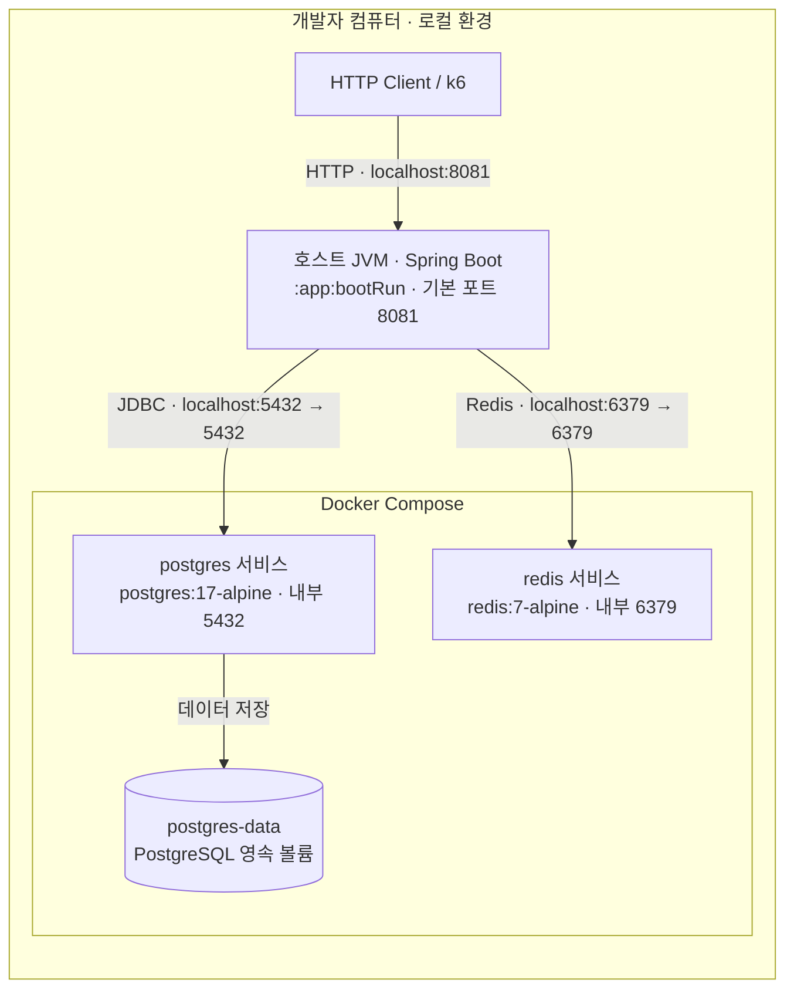

# 로컬 Deployment

이 문서는 저장소에 구성된 **로컬 개발 환경**을 설명한다. 실행 명령과 환경 변수는 [개발 안내](../development/README.md)가 소유한다. 운영 배포 토폴로지는 아직 정의되지 않았다.

[Deployment](https://c4model.com/diagrams/deployment)는 특정 환경에서 Container를 실행하는 위치와 연결을 보여 준다. 현재 [compose.yaml](../../compose.yaml)에는 PostgreSQL·Redis만 있으며 애플리케이션은 호스트 JVM에서 실행한다. 따라서 전체가 Docker나 Pod 하나에 배포된 것으로 설명하지 않는다.

PostgreSQL은 named volume을 사용한다. Redis에는 영속 볼륨·AOF·복제가 설정되어 있지 않아 컨테이너 재생성 후 순번과 ZSET이 유실될 수 있다. DB 상태 복원과 순서 보존의 한계는 [구매 대기 복구 정책](purchase-waiting.md#redis-유실-시의-한계)을 따른다.

호스트 공개 포트는 [.env.example](../../.env.example)의 `POSTGRES_PORT`, `REDIS_PORT`로 바꿀 수 있다. 호스트에서 실행하는 앱의 DB·Redis 연결 값도 [application.yml](../../app/src/main/resources/application.yml)에 맞춰 설정해야 한다. Compose용 `.env`를 수정하는 것만으로 호스트 JVM의 환경 변수가 자동 설정되지는 않는다.
