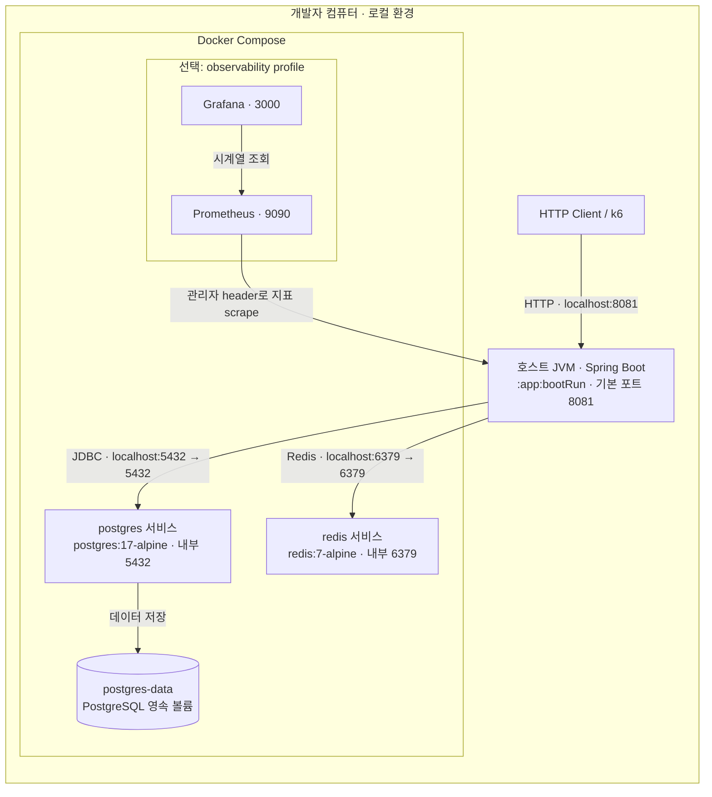

# 로컬 Deployment

이 문서는 저장소에 구성된 **로컬 개발 환경**을 설명한다. 실행 명령과 환경 변수는 [개발 안내](../development/README.md)가 소유한다. 운영 배포 토폴로지는 아직 정의되지 않았다.

[Deployment](https://c4model.com/diagrams/deployment)는 특정 환경에서 Container를 실행하는 위치와 연결을 보여 준다. 현재 [compose.yaml](../../compose.yaml)의 기본 서비스는 PostgreSQL·Redis이며 관측 서비스는 선택 profile로 실행한다. 애플리케이션은 호스트 JVM에서 실행한다. 따라서 전체가 Docker나 Pod 하나에 배포된 것으로 설명하지 않는다.

PostgreSQL은 named volume을 사용한다. Redis에는 영속 볼륨·AOF·복제가 설정되어 있지 않아 컨테이너 재생성 후 순번과 ZSET이 유실될 수 있다. DB 상태 복원과 순서 보존의 한계는 [구매 대기 복구 정책](purchase-waiting.md#redis-유실-시의-한계)을 따른다.

호스트 공개 포트는 [.env.example](../../.env.example)의 `POSTGRES_PORT`, `REDIS_PORT`로 바꿀 수 있다. 호스트에서 실행하는 앱의 DB·Redis 연결 값도 [application.yml](../../app/src/main/resources/application.yml)에 맞춰 설정해야 한다. Compose용 `.env`를 수정하는 것만으로 호스트 JVM의 환경 변수가 자동 설정되지는 않는다.

## 관측 구성과 과거 측정 환경

`observability` profile은 Prometheus v3.15.0과 Grafana 13.2.4를 추가한다. 관측 UI는 localhost에 공개하며 지표는 관리자 header로 scrape한다. `APP_METRICS_TARGET`으로 호스트 앱 주소를 지정한다. Grafana datasource·대시보드는 소스에서 자동 provisioning하고 데이터 볼륨을 유지한다.

1단계 실험은 기본 실행과 별도의 Compose project `limited-ticketing-baseline`과 앱 18081·DB 15432·Redis 16379를 사용했다. `compose.baseline.yaml`이 DB/Redis 자원 제한을 추가하며 앱 JVM은 호스트에서 256~768MB로 실행했다. 이 조건은 [과거 실측](../evaluations/load-testing/2026-10-15-stage-1-baseline.md#환경과-방법)의 기록이다. 이후 작업과 측정은 [기존 로컬 환경](../performance/load-testing.md#기존-로컬-환경-준비)을 사용하며 별도 앱·DB·Redis를 생성하지 않는다. 과거 측정 포트를 현재 실행의 기본값으로 사용하지 않는다.
