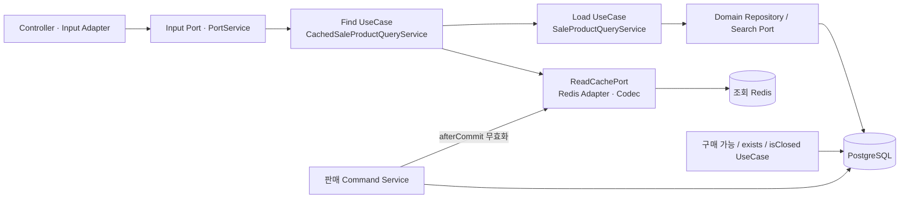
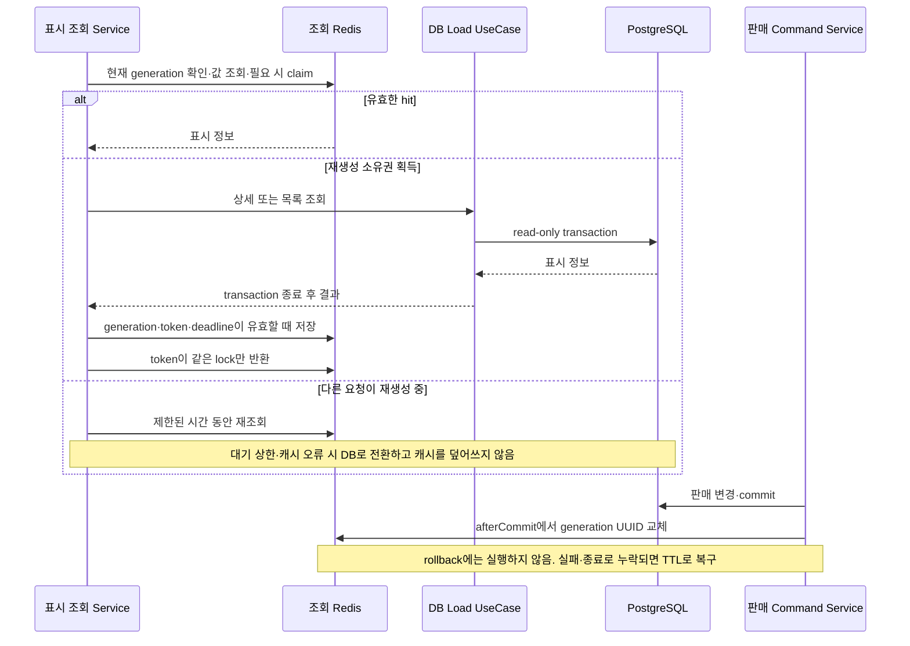

# 상품 표시 조회 캐시

상품 상세·목록의 표시 정보는 `sale` 모듈의 Cache-Aside 경로를 사용한다. 재고·구매 가능 여부·판매 종료의 내부 판정은 PostgreSQL을 직접 조회한다. 선택 이유와 비용은 [ADR 0012](../adr/0012-product-read-cache.md), 실행·측정은 [상품 조회 실험](../performance/catalog-read-cache.md)을 따른다.

## 컴포넌트와 책임

PortService는 캐시를 직접 조작하지 않고 UseCase를 호출한다. 캐시 조율에는 DB transaction을 붙이지 않으며, miss의 DB loader만 read-only transaction을 사용한다. Adapter와 Codec은 Output DTO를 사용하고 내부 UseCase DTO를 참조하지 않는다. 목록 miss는 판매 페이지와 Product 일괄 조회로 응답을 구성하며 ID를 보조 정렬로 사용한다.

## 읽기와 commit 후 무효화

현재 generation과 값 확인·claim은 Lua로 검사한다. generation을 바꾼 뒤에는 이전 key를 조회하지 않으며, 이전 소유자의 fill은 generation·lock token 검사로 거절한다. 전체 카탈로그를 무효화하므로 관계없는 상품의 hit율도 내려간다. 기존 key는 TTL로 제거하고 SCAN/KEYS/FLUSHDB로 일괄 삭제하지 않는다.

Lua의 `HIT·CLAIMED·BUSY·STALE` 응답은 Adapter 내부 `RedisCacheReadStatus` enum으로 해석한다. `STALE`는 값의 TTL 만료가 아니라 요청 generation과 현재 generation의 불일치이며 두 번까지 시도한 뒤 DB로 전환한다. Application의 `CacheLookup.Status`에는 내부 재시도 상태를 노출하지 않는다. 알 수 없는 상태·손상된 응답은 `BUSY`로 간주하지 않고 read 오류 지표를 남겨 DB로 전환하며, 임의 문자열을 lookup 지표 label로 사용하지 않는다.

## key·TTL·장애 경계

- generation: `sale-cache:{catalog}:v1:generation`. UUID이며 유실·손상 시 새 세대를 사용한다. `{catalog}`는 literal hash tag다.
- 상세: `sale-cache:{catalog}:v1:<generation>:detail:<saleId>`.
- 목록: `sale-cache:{catalog}:v1:<generation>:list:<status|ALL>:<page>:<size>:<sort>:<direction>`.
- lock은 각 데이터 key에 `:lock`을 붙이고 짧은 Lease와 UUID token을 사용한다. 올바른 token만 반환할 수 있다.
- TTL 상한은 상세 30초·목록 10초이며 하향 jitter를 적용한다. Redis 시각으로 DB 조회 전 deadline을 정하고 저장할 때 남은 시간만 부여한다. hit로 연장하지 않는다. 조정 값은 [YAML](../../app/src/main/resources/application.yml)의 `limited-ticketing.sale-cache`가 소유한다.
- 빈 목록은 캐시하고 404·DB 오류는 성공 값으로 저장하지 않는다. 손상된 JSON·형식 버전·조회 조건 불일치는 DB로 전환한다.
- Read Redis 장애는 DB로 전환하지만 장애 중 DB 부하를 제한하는 전역 입구 제어는 없다. 동시 miss의 잠금·대기는 정상 Lease 안에서 재생성 중복을 줄이며 느린 DB·eviction·장애의 중복 조회까지 없애지는 않는다.
- 판매 변경 commit 후 무효화가 누락되면 기존 TTL까지 표시가 오래될 수 있다. 캐시의 OPEN·가격을 구매 승인 근거로 사용하지 않는다.

## 저장소와 관측

기존 대기열 Redis와 별도 `redis-read` 서비스를 사용한다. 조회 Redis는 maxmemory 256MB·allkeys-lru·persistence 없음이다. generation·lock도 eviction될 수 있으므로 DB 정합성의 근거로 삼지 않는다. `saleCacheStringRedisTemplate`은 전용 연결을 사용하며 기본 대기열 `StringRedisTemplate`을 대체하지 않는다.

조회 캐시는 선택적인 최적화다. 전체 health의 Redis 항목은 필수 대기열 연결을 검사하며 조회 캐시 장애는 다음 지표로 관찰한다.

| 지표 | 의미 |
|---|---|
| `sale_cache_enabled` | 실제 캐시 활성 설정, 비교 실험의 모드 확인 |
| `sale_cache_lookup_total{kind,result}` | 상세/목록의 hit·claimed·busy 등 Redis 조회 결과 |
| `sale_cache_write_total{kind,result}` | 저장 성공 또는 generation/token/deadline에 의한 거절 |
| `sale_cache_operations_total{operation,result}` | read/store/release/decode/invalidate의 오류와 무효화 성공 |

lookup은 polling마다 증가하므로 HTTP 요청 수와 다르다. 손상된 값은 lookup hit 뒤 decode 오류로 DB 전환할 수 있다. SQL 수는 통합 테스트의 Hibernate Statistics로 검증하며 이 counter를 SQL 실행 횟수로 해석하지 않는다. 상품 ID·요청 key를 label로 사용하지 않는다.
