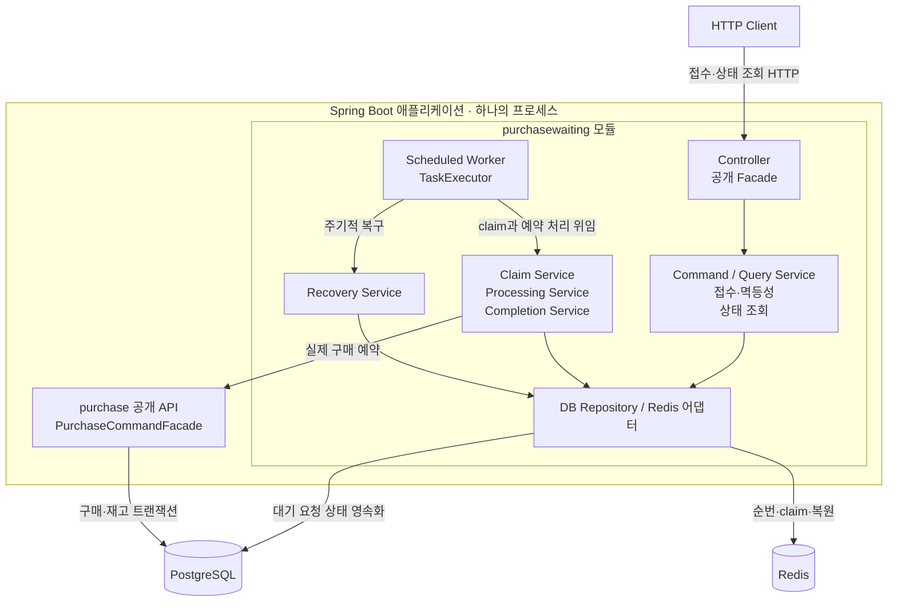

# 구매 대기 설계와 복구 정책

현재 구현된 `purchasewaiting` 모듈의 계약과 복구 정책을 설명한다. 실행 설정은 [개발 및 검증](../development/README.md#로컬-실행), 측정 절차는 [부하 테스트](../performance/load-testing.md), 남은 작업은 [로드맵](../plans/roadmap.md)에서 관리한다.

## 목적

판매 오픈 시 다수의 회원이 같은 상품의 구매 예약을 동시에 호출해도 모든 요청이 즉시 `Purchase`와 `Inventory` DB 경로에 진입하지 않게 한다. 회원은 상품별 대기열에 진입하고, 제한된 수의 요청만 순번대로 비동기 예약 처리한다.

이번 구현은 좌석 선택이 없는 한정 수량 상품을 기준으로 한다. 따라서 입장 허용된 회원이 추가 입력을 수행하는 대신, 워커가 기존 구매 예약 유스케이스를 자동 실행한다.

## 선택 배경

구매 대기 접수·처리·복구를 별도 업무 모듈로 둔 이유와 Redis·DB의 역할 분담은 [ADR 0003](../adr/0003-purchase-waiting.md)에 기록한다.

## 구현 범위

### 구현한 기능

- `purchasewaiting` 애플리케이션 모듈 추가
- `reservation_queue_entries` DB 테이블과 상태 전이
- Redis ZSET 기반 대기 순서와 처리 중 요청 집합
- Lua 스크립트로 상품별 제한 인원만 원자적으로 claim
- `POST /api/sale-products/{saleProductId}/queue-entries` 대기열 진입 API
- `GET /api/queue-entries/{queueEntryId}` 상태 조회 API
- 제한된 워커가 기존 `PurchaseCommandFacade.reserve()`를 호출하는 비동기 예약 처리
- Redis 등록 실패와 처리 중 워커 중단에 대비한 DB 기반 복구
- keyset cursor 기반 전체 WAITING 복원과 Redis 고아 항목 정리
- 종료된 판매의 Redis 키 수명 주기 정리

### 후속 단계

다음 단계의 순서와 완료 기준은 [플래시세일 구현 계획](../plans/2026-10-15-flash-sale-implementation-plan.md)을 따른다. Kafka·Outbox는 학습 목표에 따라 3단계 필수 범위로 계획했으며 현재는 미구현이다. 기존 Redis ZSET 계약을 변경할 때는 해당 단계 스펙·검증·현재 문서를 함께 갱신한다.

## API 계약

### 대기열 진입

```text
POST /api/sale-products/{saleProductId}/queue-entries
X-Member-Id: 42
Idempotency-Key: purchase_42_...

202 Accepted
{
  "code": "SUCCESS",
  "data": {
    "queueEntryId": "UUID",
    "status": "WAITING",
    "position": 153
  }
}
```

같은 회원이 같은 `Idempotency-Key`로 재시도하면 기존 Queue Entry를 반환한다. 같은 회원이 같은 상품에 WAITING 또는 PROCESSING 상태로 다른 키를 사용해 중복 진입하면 충돌로 처리한다.

### 상태 조회

```text
GET /api/queue-entries/{queueEntryId}
X-Member-Id: 42
```

응답 상태는 `WAITING`, `PROCESSING`, `RESERVED`, `SOLD_OUT`, `FAILED`다. `WAITING` 상태에서만 Redis `ZRANK` 기반 현재 순번을 반환한다. 순번은 다른 회원이 처리되면서 변하므로 참고용 값이다.

## 데이터 모델

```text
reservation_queue_entries
- id UUID PK
- member_id
- sale_product_id
- purchase_request_key
- queue_sequence
- status
- purchase_id nullable
- failure_code nullable
- created_at
- processing_started_at nullable
- completed_at nullable
```

`id`는 Redis와 DB 저장 전부터 같은 식별자가 필요하므로 UUID를 사용한다. 일반 Aggregate의 DB IDENTITY 전략과 달리, 이 경우에는 영속화 전 식별자가 실제로 필요하다.

`member_id + purchase_request_key`는 멱등성을 보장한다. WAITING/PROCESSING 상태에 대한 `member_id + sale_product_id` partial unique index는 같은 상품의 중복 대기를 막는다. 구매 완료 후의 1인 1개 정책은 기존 `purchases.active_purchase_key` 제약이 최종 방어선이다.

## Redis 키

```text
waiting:sale:{saleProductId}      # ZSET: score=queue_sequence, member=queueEntryId
processing:sale:{saleProductId}   # ZSET: score=claim timestamp, member=queueEntryId
sequence:sale:{saleProductId}     # String: INCR sequence
```

대기 순번은 서버 시각이 아니라 Redis `INCR` 값으로 결정한다. 같은 밀리초에 들어온 요청도 안정적인 순서를 가진다.

처리 슬롯은 상품별 설정값만큼 동시에 열리므로, 먼저 claim된 묶음 안에서는 실제 DB 예약 완료 순서가 달라질 수 있다. ZSET claim은 당시 저장된 순번 순서로 대상을 선택하며, 슬롯을 1로 줄이면 정상 처리의 병렬 완료 순서 차이를 줄일 수 있다. 장애·재시도·Redis 유실까지 포함한 엄격한 FIFO 보장은 현재 계약에 포함하지 않는다.

Redis 접근 책임은 순번 발급용 `QueueSequenceGenerator`, 정상 처리용 `ReservationQueueStore`, 복구용 `ReservationQueueRecoveryStore`로 분리한다. 실제 구현체는 `ReservationQueueRedisKeys`를 공유하므로 키 문자열이 여러 클래스에 중복되지 않는다. waiting과 processing 사이의 claim은 Lua 원자 연산이므로 두 개의 독립 Store로 나누지 않는다.

## C3 · 구매 대기 컴포넌트



이 그림은 구매 대기 처리에서 독립적으로 바뀌는 책임만 묶어 보여 준다. 각 컴포넌트는 프로세스나 배포 단위가 아니다. 실제 구현의 기준은 [Worker](../../purchasewaiting/src/main/java/com/example/limitedticketing/purchasewaiting/infrastructure/scheduler/ReservationQueueWorker.java)와 [Application Service](../../purchasewaiting/src/main/java/com/example/limitedticketing/purchasewaiting/application/command/service)다. Repository·출력 Port의 의존 방향은 [모듈 내부 설계](module-boundaries.md#레이어-구조)를 따른다.

## 처리 흐름

```text
대기열 진입
  -> Redis INCR로 sequence 발급
  -> DB QueueEntry(WAITING) 저장
  -> Redis waiting ZSET 등록

스케줄러
  -> Lua로 processing 수를 확인
  -> 여유 슬롯만큼 waiting ZSET의 앞 순번 claim
  -> processing ZSET으로 이동
  -> 제한된 TaskExecutor가 QueueEntry 처리

워커
  -> DB QueueEntry WAITING -> PROCESSING
  -> PurchaseCommandFacade.reserve()
  -> 성공: RESERVED + purchaseId
  -> 재고 부족: SOLD_OUT
  -> Redis processing ZSET에서 제거
```

Redis claim 뒤 워커가 중단될 수 있으므로 PROCESSING 상태가 설정 시간보다 오래 남으면 복구 작업이 WAITING으로 되돌려 Redis ZSET에 재등록한다. Redis 등록 자체가 실패한 WAITING DB 행도 복구 작업이 다시 등록한다.

복구 작업은 다음 순서로 실행한다.

```text
오래된 DB PROCESSING을 배치 단위로 모두 WAITING으로 전환
  -> 트랜잭션 커밋
  -> 상품별 (queue_sequence > cursor) keyset 조회로 전체 WAITING을 Redis에 보충
  -> Redis waiting/processing ID와 DB ID를 비교해 DB에 없는 ID 제거
  -> CLOSED 판매이며 DB에 WAITING/PROCESSING이 없으면 Redis 3개 키 삭제
```

`QUEUE_RECOVERY_BATCH_SIZE`의 기본값은 1,000이다. OFFSET을 사용하면 앞 항목의 상태 변경에 따라 누락이나 중복이 생길 수 있으므로, 상품별로 단조 증가하는 `queue_sequence`를 cursor로 사용한다.

`ReservationQueueWorker`는 `@Scheduled`로 요청을 가져오고 `reservationQueueTaskExecutor`에 구매 처리 작업을 제출한다.

TaskExecutor의 최대 스레드 수는 현재 `QUEUE_MAX_CONCURRENT_PROCESSING`과 같은 값이다. 단일 판매 상품에서는 Redis 슬롯과 실제 실행 수가 일치한다. 여러 상품이 동시에 열리면 Redis 슬롯은 상품별로 계산되지만 TaskExecutor는 애플리케이션 전체에서 공유되므로, 상품 간 공정성이나 전역 처리량 제한이 필요해지는 시점에 별도 정책을 추가한다.

## 정합성 규칙

- Redis ZSET은 순서와 동시 처리 제한용 보조 저장소다.
- 구매 생성과 재고 예약의 최종 정합성은 기존 PostgreSQL 트랜잭션이 보장한다.
- Redis 분산 락은 사용하지 않는다. 상품별 hot row의 대기를 Redis 락으로 옮기는 것은 처리량 개선이 아니다.
- Redis 재고 카운터도 이번 단계에서는 사용하지 않는다. DB 재고와 Redis 수량의 보상·복구 문제를 추가하지 않기 위해서다.
- 알려진 비즈니스 실패(재고 부족)는 Queue Entry의 최종 상태로 저장한다. 예상하지 못한 시스템 오류는 PROCESSING 상태를 유지해 복구 대상이 된다.
- Redis에서 claim한 ID가 DB에 없거나 이미 WAITING이 아니면 `claim()`은 `Optional.empty()`를 반환한다. Worker는 이를 오류로 반복하지 않고 Redis processing 항목을 제거한다.
- Redis 고아 항목은 PostgreSQL에 같은 UUID의 QueueEntry가 없는 waiting/processing 구성원이다. 복구 작업은 이를 두 ZSET에서 제거한다.
- 판매가 `CLOSED`이고 PostgreSQL에 WAITING/PROCESSING 항목이 없을 때 `waiting`, `processing`, `sequence` 키를 삭제한다. DB 초기화 등으로 판매 자체가 존재하지 않는 키도 삭제하며, 판매 중인 대기열 키는 삭제하지 않는다.

### Redis 유실 시의 한계

현재 Compose의 Redis는 로컬 개발용이며 AOF, replica, 영속 볼륨을 설정하지 않는다. Redis 컨테이너 재생성 시 ZSET과 sequence가 초기화될 수 있다. DB 대기열은 복구되지만 대기 순서가 섞일 수 있으므로, 운영에서 순번 보존이 중요하면 Redis 영속화와 고가용성 구성을 추가해야 한다.

## 복구 문제와 해결

로컬 부하 테스트 후 PostgreSQL만 초기화하고 Redis를 유지하면 이전 실행의 UUID가 ZSET에 남을 수 있었다. 재시작한 Worker가 이 ID를 claim한 뒤 필수 조회 Finder를 호출하면서 `Queue entry not found` 예외가 반복됐고, 예외 때문에 processing ZSET에서도 제거되지 않았다.

또한 기존 복구 조회는 `LIMIT 1000`만 사용했다. 첫 1,000건이 계속 WAITING이면 매 실행마다 같은 행만 조회하므로 1,001번째 이후 항목은 Redis에 복원되지 않는다. 이는 조회 성능 문제가 아니라 복구 누락을 일으키는 정확성 문제다.

다음과 같이 해결했다.

1. `claim()`은 DB 부재와 WAITING이 아닌 상태를 정상적인 claim 실패로 취급해 `Optional.empty()`를 반환한다.
2. Worker는 빈 결과를 받으면 해당 UUID를 processing ZSET에서 제거한다.
3. Recovery는 상품별 `queue_sequence` keyset cursor로 WAITING 행을 끝까지 순회한다.
4. Redis waiting/processing 구성원을 DB와 비교하고 DB에 없는 UUID를 제거한다.
5. 판매 종료 후 활성 QueueEntry가 없거나 판매 자체가 DB에 없으면 세 Redis 키를 삭제해 다음 실행에 상태가 남지 않게 한다.

환경명과 판매 세대 식별자를 Redis 키에 포함하는 방식은 이번 범위에 포함하지 않았다. 따라서 DB를 초기화해 ID가 재사용될 수 있는 로컬 테스트에서는 [fixture 준비 명령](../performance/load-testing.md#1-테스트-데이터와-환경-변수-준비)에서 해당 판매 ID의 세 키를 먼저 삭제한다.

## 검증 기준

1. 같은 요청 키 재시도는 Queue Entry 하나만 생성한다.
2. 다른 요청 키의 같은 회원/상품 중복 대기는 거부한다.
3. 제한 인원이 넘는 요청은 WAITING에 남고, 처리 중 수는 설정값을 넘지 않는다.
4. 워커가 예약을 완료하면 Purchase와 Inventory가 기존 정책대로 변경된다.
5. 재고 부족은 Queue Entry를 SOLD_OUT으로 바꾼다.
6. Redis ZSET에 없는 WAITING DB 행은 복구 배치보다 많아도 모두 다시 등록된다.
7. 오래된 PROCESSING DB 행은 WAITING으로 돌아가 다시 처리 가능해진다.
8. DB에 없는 Redis waiting/processing UUID는 복구 작업이 제거한다.
9. CLOSED 판매에 활성 QueueEntry가 없으면 Redis 세 키가 삭제된다.
10. Spring Modulith 검증으로 purchasewaiting -> purchase/member/sale 공개 API 의존성만 허용한다.
