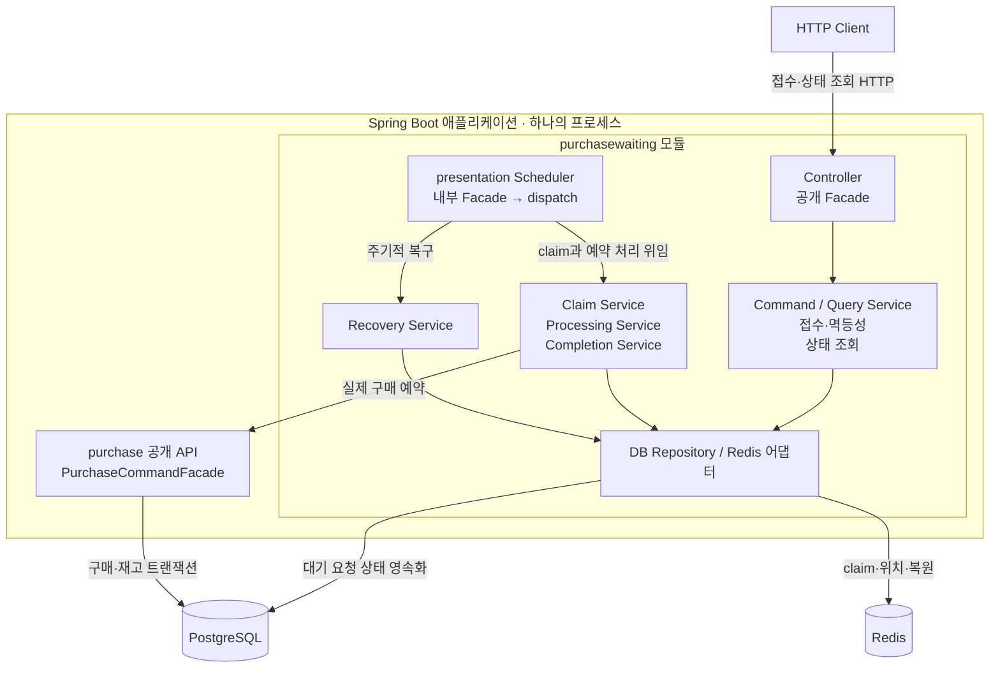

# 구매 대기 계약과 처리 흐름

`purchasewaiting`은 구매 진입 요청의 수명 주기를 소유한다. PostgreSQL은 요청·순번·처리 권한의 원장, Redis ZSET은 입장 선택과 위치 조회를 위한 재구성 가능한 저장소다. 실제 구매·재고 예약은 `purchase` 공개 API에 위임한다. 선택 이유와 비용은 [ADR 0006](../adr/0006-durable-queue-admission-and-attempts.md)에 기록한다.

## 접수와 조회

- 상품별 `WAITING + PROCESSING` 최대 10,000건이다. 초과는 429 `QUEUE_CAPACITY_EXCEEDED`다.
- 회원·상품별 새 요청은 1초당 1회다. 초과는 429 `QUEUE_RATE_LIMITED`다. 이미 수락한 같은 요청 키의 재전송은 기존 원장을 반환한다. 동시 재전송도 상품 잠금 아래 재확인한다.
- 동일 회원·상품의 활성 대기는 DB partial unique index로 하나만 허용한다. 속도 제한 시간이 지나도 다른 키로 중복 대기하면 409다.
- 수락 전 Redis 불가는 503 `QUEUE_UNAVAILABLE`이며 원장을 생성하지 않는다. 429/503은 `Retry-After: 1`을 보낸다.
- DB 커밋 뒤 Redis 등록 실패는 202를 유지하고 복구가 등록한다. 상태 조회는 소유권 확인 후 DB 기준으로 응답한다. Redis 장애 시 WAITING의 position은 null이다.
- 직접 예약 HTTP는 `baseline` profile에서만 제공한다. 기본 실행의 구매 진입은 대기 API를 사용한다. 내부 예약 Facade·결제·취소는 그대로 사용한다.

## 원장과 Redis 키

`reservation_queue_entries`는 UUID, 회원·판매·요청 키, 순번, 상태, 구매 ID·실패 코드와 생성/처리/완료 시각을 저장한다. PROCESSING은 `processing_token`과 `lease_until`도 저장한다. `reservation_queue_sequences`는 상품별 마지막 순번을 보존한다.

```text
waiting:sale:{saleId}             ZSET: score=DB queue_sequence, member=entry UUID
processing:sale:{saleId}          ZSET: score=claim timestamp, member=entry UUID
processing-tokens:sale:{saleId}   HASH: entry UUID → attempt token
admission:sale:{saleId}:member:{memberId}  SET NX, TTL 1초
```

순번은 PostgreSQL upsert로 발급하며 `1..2^53-1` 범위다. Redis `sequence:sale:*`는 더 이상 발급에 쓰지 않는 이전 키이며 정리 대상으로만 남긴다. 기존 동점도 복구하기 위해 DB cursor는 `(queue_sequence, UUID)`다. ZSET은 score와 UUID 문자열 순으로 선택한다. 병렬 완료의 FIFO나 Redis 복원 전에 이미 입장한 작업의 취소는 보장하지 않는다.

## C3 · 구매 대기 컴포넌트



이 그림은 구매 대기 처리에서 독립적으로 바뀌는 책임만 묶어 보여 준다. 각 컴포넌트는 프로세스나 배포 단위가 아니다. 실제 구현의 기준은 [Scheduler](../../purchasewaiting/src/main/java/com/example/limitedticketing/purchasewaiting/presentation/scheduler/ReservationQueueScheduler.java)와 [Application Service](../../purchasewaiting/src/main/java/com/example/limitedticketing/purchasewaiting/application/command/service)다. Repository·출력 Port의 의존 방향은 [모듈 내부 설계](module-boundaries.md#레이어-구조)를 따른다.

## 처리 흐름

1. 기존 요청 키면 원장을 반환한다. 구매 자격을 확인하고 상품별 DB advisory transaction lock 아래 동시 재전송·속도·수용량을 판정한다.
2. DB 순번을 발급해 WAITING을 저장한다. 커밋 후 Redis에 등록한다.
3. presentation Scheduler → 내부 Worker Facade → Application dispatch가 실행 여유를 확인한다. 상품 선택 시작점을 순환한다.
4. [claim Lua](../../purchasewaiting/src/main/resources/redis/queue-claim.lua)가 등록된 대기 중 앞 순번을 processing으로 옮기고 토큰을 기록한다.
5. DB 상품 잠금·처리 수 상한 확인 후 `status=WAITING` 조건부 갱신으로 토큰·lease를 저장한다. 실행 거부는 해당 토큰의 권한만 반환하고 원래 순번으로 재대기한다.
6. 실제 처리는 행 잠금 아래 상태·토큰·lease를 확인한다. `REQUIRES_NEW` 예약이 성공하면 RESERVED, 품절은 SOLD_OUT, 다른 업무 실패는 FAILED로 확정한다. 시스템 오류는 PROCESSING을 유지한다.
7. 결과 커밋 후 Redis 슬롯을 같은 토큰으로 반환한다. 구매 커밋과 결과 기록 사이 중단은 기존 구매 멱등성으로 복구한다.

전체 Executor는 기본 10개 스레드·대기 버퍼 0이다. 상품별 PROCESSING 상한도 기본 10이며 DB가 최종 방어선이다. 이 값은 서로 별도 설정이다. 다중 앱의 전역 제한은 아직 구현하지 않았다.

## 복구

- 만료 PROCESSING을 `FOR UPDATE SKIP LOCKED`로 읽는다. 실행 중 행 잠금은 lease가 지났어도 건너뛴다. 회수한 행을 WAITING으로 커밋한 뒤 이전 토큰으로 Redis를 재대기한다.
- 상품별 WAITING을 복합 cursor로 끝까지 읽는다. 위치가 없으면 별도 트랜잭션에서 행을 잠그고 여전히 WAITING인지 확인한 뒤 원래 score로 복원한다.
- Redis 구성원 중 DB에 없거나 이미 최종 상태인 항목을 정리한다. CLOSED/없는 판매이고 활성 요청도 없으면 waiting·processing·token·이전 sequence 키를 제거한다.

Redis 영속화·replica는 현재 로컬 구성에 없다. 유실 후 순번과 대기는 DB에서 복구하지만 복구 전 위치 조회·신규 접수·진행 속도는 영향을 받는다. DB 자동 failover와 여러 프로세스의 장애 평가는 후속 범위다.

## 적용과 검증

V6 적용 전 이전 앱 Worker를 중지한다. 기존 마지막 순번은 원장 MAX로 초기화하고, 기존 PROCESSING은 새 토큰과 기존 처리 시작 시각+30초 lease로 변환한다. 혼합 버전 Worker를 동시에 실행하지 않는다.

Worker 10개가 결과 확정까지 외부 연결을 유지하며 내부 예약에도 연결을 사용하므로 기본 Hikari 풀은 30이다. 환경 설정과 연결 여유 조건은 [개발 안내](../development/README.md)를 따른다. 실행 중인 긴 트랜잭션은 lease만으로 강제 회수하지 않는다.

[업무·아키텍처 테스트 기준](../development/testing.md)과 [2단계 평가](../evaluations/load-testing/2026-10-16-stage-2-queue-consistency.md)에 검증 범위와 한계를 기록한다.
