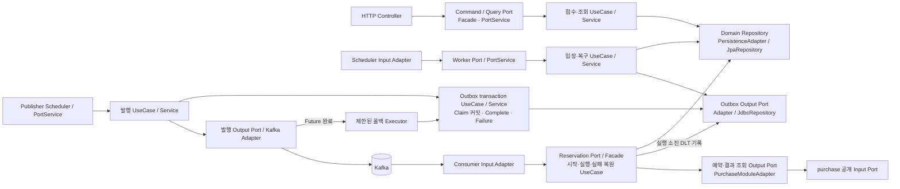

# 구매 대기 계약과 처리 흐름

`purchasewaiting`은 구매 진입 요청의 수명 주기를 소유한다. PostgreSQL은 요청·순번·처리 권한의 원장, Redis ZSET은 입장 선택과 위치 조회를 위한 재구성 가능한 저장소다. 실제 구매·재고 예약은 PurchaseReservationPort와 PurchaseModuleAdapter를 거쳐 `purchase` 공개 Input Port에 위임한다. 선택 이유와 비용은 [ADR 0006](../adr/0006-durable-queue-admission-and-attempts.md)에 기록한다.

## 접수와 조회

- 상품별 `WAITING + DISPATCHED + PROCESSING` 최대 10,000건이다. 초과는 429 `QUEUE_CAPACITY_EXCEEDED`다.
- 회원·상품별 새 요청은 1초당 1회다. 초과는 429 `QUEUE_RATE_LIMITED`다. 이미 수락한 같은 요청 키의 재전송은 기존 원장을 반환한다. 동시 재전송도 상품 잠금 아래 재확인한다.
- 동일 회원·상품의 활성 대기는 DB partial unique index로 하나만 허용한다. 속도 제한 시간이 지나도 다른 키로 중복 대기하면 409다.
- 수락 전 Redis 불가는 503 `QUEUE_UNAVAILABLE`이며 원장을 생성하지 않는다. 429/503은 `Retry-After: 1`을 보낸다.
- DB 커밋 뒤 Redis 등록 실패는 202를 유지하고 복구가 등록한다. 상태 조회는 소유권 확인 후 DB 기준으로 응답한다. Redis 장애 시 WAITING의 position은 null이다.
- 직접 예약 HTTP는 `baseline` profile에서만 제공한다. 기본 실행의 구매 진입은 대기 API를 사용한다. 내부 예약 Facade·결제·취소는 그대로 사용한다.

## 원장과 Redis 키

`reservation_queue_entries`는 UUID, 회원·판매·요청 키, 순번, 상태, 구매 ID·실패 코드와 생성/처리/완료 시각을 저장한다. PROCESSING은 `processing_token`과 `lease_until`도 저장한다. `reservation_queue_sequences`는 상품별 마지막 순번을 보존한다.

```text
waiting:sale:{saleId}             ZSET: score=DB queue_sequence, member=entry UUID
processing:sale:{saleId}          ZSET: score=claim timestamp, member=entry UUID
processing-tokens:sale:{saleId}   HASH: entry UUID → attempt token
admission:sale:{saleId}:member:{memberId}  SET NX, TTL 1초
```

순번은 PostgreSQL upsert로 발급하며 `1..2^53-1` 범위다. Redis `sequence:sale:*`는 더 이상 발급에 쓰지 않는 이전 키이며 정리 대상으로만 남긴다. 기존 동점도 복구하기 위해 DB cursor는 `(queue_sequence, UUID)`다. ZSET은 score와 UUID 문자열 순으로 선택한다. 병렬 완료의 FIFO나 Redis 복원 전에 이미 입장한 작업의 취소는 보장하지 않는다.

## C3 · 구매 대기 컴포넌트



Controller·Scheduler·Consumer는 입력 Adapter다. Application의 Facade가 여러 UseCase를 조합하고, 단순 Port 연결은 PortService가 맡는다. Aggregate 영속성은 Domain Repository, Outbox·Kafka·Redis·다른 모듈 기능은 Application Output Port로 구분한다.

## 상태와 처리 흐름

| 내부 상태 | 의미 | 조회 API |
|---|---|---|
| WAITING | 입장 대기 | WAITING |
| DISPATCHED | Outbox 저장 완료, Kafka 전달·실행 시작 대기 | PROCESSING |
| PROCESSING | 실행 횟수와 lease를 DB에 저장하고 예약 실행 중 | PROCESSING |
| RESERVED / SOLD_OUT / FAILED | 예약 성공 / 품절 / 업무 또는 최종 기술 실패 | 같은 이름 |

1. 기존 요청 키는 원장을 반환한다. 상품별 DB 잠금 아래 속도·수용량을 확인하고 순번과 WAITING을 저장한다. 커밋 후 Redis에 등록한다.
2. Dispatcher는 Redis에서 앞 순번을 claim한다. DB의 전역 → 상품 잠금 순서로 `DISPATCHED + PROCESSING` 상한을 확인한다. 기본 전역·상품별 상한은 각각 10이며 여러 Dispatcher가 공유한다. 각 실행의 상한 설정을 동일하게 유지한다.
3. WAITING→DISPATCHED와 예약 Outbox를 같은 transaction으로 커밋한다. 전달 대기에는 실행 lease를 시작하지 않는다. DB 입장이 거절되면 같은 token으로 Redis를 반환한다.
4. Publisher는 In-flight 용량을 먼저 확보하고 미발행 Outbox를 `FOR UPDATE SKIP LOCKED`로 Claim한다. Claim ID·30초 Lease·발행 시도를 짧은 transaction에서 커밋한 뒤 Kafka Future를 등록한다. ACK·실패의 DB 기록은 제한된 콜백 Executor와 별도 transaction으로 처리한다. 실패는 실제 처리 시각부터 1·2·4·8·16·30초 상한의 backoff를 적용한다. ACK 뒤 DB 기록 실패는 Lease 만료 후 동일 eventId의 중복 발행을 허용한다.
5. Consumer는 JSON version·필드·key와 원장의 event/token을 확인한다. 짧은 시작 transaction에서 실행 횟수와 30초 lease를 커밋한다. 별도 실행 transaction에서 행 잠금·token·lease를 확인하고 `purchase`의 예약 Input Port를 호출한다. 구매 예약은 기존 `REQUIRES_NEW` transaction을 사용한다.
6. 결과 원장 커밋 후 offset을 저장한다. RESERVED·SOLD_OUT·업무 FAILED·이전 token·완료 중복은 재예약하지 않는다. 현재 token의 PROCESSING 중복은 BUSY로 구분해 ACK 대신 nack한다. 첫 실행의 실패 기록보다 중복 ACK가 앞서 재시도를 유실시키는 것을 막는다. Redis 슬롯 반환 실패는 원장의 예약을 재실행시키지 않으며 복구가 정리한다.
7. 기술 오류는 같은 업무 키로 최초 포함 총 3회 실행한다. 횟수는 롤백·재시작에도 유지한다. 소진 시 기존 구매를 조회해 RESERVED를 복원하거나, 구매가 없다고 확인되면 FAILED와 DLT 알림 Outbox를 함께 저장한다.

로컬 Executor 직접 제출과 Broker 장애 시 직접 실행 fallback은 없다. Kafka 메시지는 eventId·version·시간·대기 ID·상품 ID·token 중심 JSON이며 가격·재고를 복제하지 않는다. `saleProductId`가 key이며 같은 상품은 한 partition으로 전달된다. topic은 각각 6 partitions, 로컬 RF3·minISR2다. 전체 계약은 [3단계 스펙](../plans/2026-10-19-stage-3-kafka-outbox.md), 결정 이유는 [ADR 0010](../adr/0010-kafka-reservation-outbox.md)을 따른다.

## Outbox 비동기 발행 경계

`PublishReservationOutboxService`는 내부 UseCase의 기술 발행 흐름을 조율한다. `NEVER`로 이미 열린 transaction의 호출을 Claim·전송 전에 거부한다. 이를 통해 호출자가 보유한 DB 연결·잠금이 전송 대기 동안 남는 것을 방지한다. `OutboxTransactionUseCase`의 구현인 `OutboxTransactionService`가 Claim·Complete·Failure를 각각 `REQUIRES_NEW`, timeout 5초로 실행한다. 이 시간은 DB transaction 제한이며 Hikari 연결 획득 대기나 전체 발행 완료 시간의 상한은 아니다.

인스턴스별 Semaphore 기본 10개와 batch 10개를 사용한다. Claim 전에 확보하고, 실제 Claim이 적으면 남는 용량을 반환한다. Kafka ACK 대기·콜백 대기·DB 결과 기록까지 Permit을 점유한다. DB Claim 실패·콜백 실행 거부·결과 저장 오류에서도 Permit을 반환한다.

`ReservationMessagePublisherPort`는 `CompletableFuture<Void>`를 반환한다. Kafka Adapter는 `KafkaTemplate.send()`의 Future를 연결하며 `get`·`join`·`@Async`·`runAsync`를 사용하지 않는다. 전송 호출 자체는 metadata·buffer 확보 때문에 `max.block.ms=5000`까지 기다릴 수 있지만 DB transaction과 행 잠금은 보유하지 않는다. ACK 전달에는 `delivery.timeout.ms=5000`이 적용된다. [Spring Kafka 전송 계약](https://docs.spring.io/spring-kafka/reference/kafka/sending-messages.html)을 따른다.

Kafka 완료 콜백에서는 DB를 직접 호출하지 않고 전용 Executor에 넘긴다. 기본 2개 스레드·대기 큐 10개·AbortPolicy를 사용한다. 포화·종료로 실행이 거부되거나 DB 기록이 실패하면 Claim을 그대로 두고 Lease 만료 후 재선택한다. 완료·실패 UPDATE는 미발행·동일 claimId·미만료 Lease를 모두 확인한다. 이전 콜백은 새 소유자나 완료 상태를 덮어쓰지 못한다.

`publish_attempts`는 Claim 시 증가해 전송 전 프로세스 종료도 시도로 남긴다. 예약의 `execution_attempts` 3회 예산과 다르다. Lease는 중복 전송을 막는 절대 시간 보장이 아니다. 지연된 전송·콜백은 Lease 이후 중복될 수 있고 Consumer의 업무 멱등성으로 보호한다. 여러 Publisher·재발행의 엄격한 전송 FIFO는 보장하지 않는다. 선택 이유와 감수한 비용은 [ADR 0011](../adr/0011-asynchronous-outbox-claim-lease.md)을 따른다.

## 복구

- 만료 PROCESSING은 `FOR UPDATE SKIP LOCKED`로 읽는다. 실행 중 잠긴 행은 건너뛴다. 예산이 남으면 WAITING과 원래 순번으로 복구하고 이전 token을 무효화한다. 소진됐으면 기존 구매 복원 또는 FAILED+DLT 경로로 보낸다.
- DISPATCHED에는 실행 lease가 없다. 전달 지연만으로 자동 WAITING 전환하지 않는다. `reservation.dispatched.oldest.seconds`로 지연을 확인한다.
- 잘못된 JSON·version·key는 원본과 Kafka 위치를 DLT에 격리한 뒤 offset을 저장한다. DB 접근 불가·결과 확인 불가·DLT 전달 실패는 성공으로 추정하지 않고 유한한 재시도 후 Consumer를 정지한다. 원인을 해결한 뒤 Worker를 재시작한다.
- 상품별 WAITING은 `(queue_sequence, UUID)` cursor로 끝까지 복원한다. Redis의 최종·없는 항목은 정리하고, 종료·없는 판매에 활성 요청이 없으면 키를 제거한다. Redis에는 현재 영속화·replica가 없다.

## 관리자 재처리

`POST /api/admin/queue-entries/{id}/replay`는 관리자만 호출한다. 기술 FAILED 또는 발행 완료 후 60초 이상 지난 DISPATCHED를 대상으로 한다. 실행 중 PROCESSING·미발행·업무 실패·성공·품절은 409다. 재활성화는 수용량과 동일 회원·상품의 다른 활성 요청을 검사한다.

이미 구매가 있으면 결과를 복원한다. 없으면 같은 ID·순번·요청 키로 WAITING을 저장하고 이전 token을 무효화한다. 기술 FAILED는 실행 예산을 초기화하고, 지연 DISPATCHED는 사용한 횟수를 유지한다. 동시 재처리는 하나만 전환한다. DB 커밋 후 Redis 동기화가 실패해도 원장은 유지한다.

## 적용과 검증

V7 적용 전 이전 Worker를 중지한다. 기존 PROCESSING의 token·lease를 보존하고 실행 횟수를 1로 초기화한다. 이미 적용된 V1–V6 migration은 변경하지 않는다. 혼합 버전 Worker를 동시에 실행하지 않는다.

비동기 Publisher는 V8의 `claim_id`·`claim_until`을 사용한다. V7 파일을 수정하지 않고 V8을 추가한다. 전환 시 동기 Publisher를 사용하는 이전 Worker를 모두 중지한 뒤 migration과 새 Worker를 실행한다. 이전 Publisher는 새 Claim을 이해하지 못하므로 혼합 실행하지 않는다. 미발행 Outbox와 eventId·payload는 그대로 유지한다.

기본 Hikari 풀은 30이며 Kafka Consumer concurrency는 프로세스당 3이다. 예약의 내부 transaction에 추가 연결이 필요하므로 실제 Consumer 수·HTTP·복구·Publisher를 고려해 연결 여유를 둔다. DB 자동 failover와 다중 앱 처리량 평가는 별도 범위다. 검증 책임은 [테스트 기준](../development/testing.md), 실제 실험 조건·한계는 [평가 기록](../README.md)을 따른다.

## Port/Adapter 구조

업무 명칭은 PurchaseWaiting으로 통일했다. [ADR 0007](../adr/0007-purchasewaiting-ports-and-adapters.md)의 입력·출력 infrastructure 배치는 유지하고, [ADR 0008](../adr/0008-application-entry-orchestration.md)에 따라 Controller·Scheduler·Consumer 자체를 입력 Adapter로 본다. 업무 조합과 Port 구현은 Application이 맡는다. 다른 모듈도 동일한 입력·업무·출력 책임을 사용한다.

```text
purchasewaiting/
├── application/
│   ├── port/in/                 Input Port와 외부 Input/Output DTO
│   │   └── worker/              모듈 내부 Worker Port와 전용 DTO
│   ├── port/out/                외부 기능 계약과 작업 DTO
│   ├── usecase/                 업무 interface와 Command/Query/Result
│   ├── facade/                  공개 Port 구현·여러 UseCase 조합
│   └── service/                 UseCase 구현·트랜잭션, 단순 진입 Port 연결
├── domain/model/                PurchaseWaitingEntry·PurchaseWaitingStatus
├── domain/exception/            PurchaseWaitingException
├── domain/repository/           PurchaseWaitingEntryRepository·저장 결과
└── infrastructure/adapter/
    ├── in/                      Controller·Scheduler·Consumer 등 Input Adapter
    │   ├── web/                 Controller·HTTP Response
    │   ├── scheduler/           Scheduler
    │   └── messaging/           Kafka Consumer
    └── out/                     Driven Adapter
        ├── persistence/         JPA Entity·Repository·DB 순번·Outbox JdbcRepository
        ├── redis/               대기·복구·입구 제한
        ├── module/              Member/Sale/Purchase 공개 계약 연결
        ├── messaging/           Kafka Publisher
        └── id/                  UUID 발급
```

### 호출과 책임

```text
HTTP Controller → PurchaseWaitingCommandPort → PurchaseWaitingCommandFacade
 → EnqueuePurchaseWaitingUseCase → EnqueuePurchaseWaitingService
 → Domain Repository → PurchaseWaitingPersistenceAdapter

HTTP Controller → PurchaseWaitingQueryPort → PurchaseWaitingQueryPortService
 → FindPurchaseWaitingUseCase → FindPurchaseWaitingService

Scheduler → PurchaseWaitingWorkerPort → PurchaseWaitingWorkerPortService
 → Dispatch/Recover UseCase → Service → Output Port → Adapter

Process Service → ReserveWaitingPurchaseUseCase → ReserveWaitingPurchaseService
 → PurchaseReservationPort → PurchaseModuleAdapter → purchase의 Input Port
```

Controller는 HTTP 경로·헤더·인증 주체를 Input으로 변환하고 HTTP 응답을 만든다. Scheduler는 실행 주기를 맡는다. 이들은 Input Port를 호출하며 내부 UseCase나 구현 Service를 직접 참조하지 않는다.

PurchaseWaitingCommandFacade가 접수 UseCase의 UUID를 받아 조회 UseCase를 호출한다. Facade 전체를 transaction으로 감싸지 않아 접수 커밋과 Redis afterCommit 반영 후 조회하는 기존 경계를 유지한다. 단순 조회와 Worker 진입은 각각 PurchaseWaitingQueryPortService·PurchaseWaitingWorkerPortService가 Port를 구현해 내부 UseCase로 연결한다. 조합이 없는 기능에 Facade를 일괄 추가하지 않는다.

같은 모듈의 Application 내부 업무 호출은 UseCase interface를 사용하고, 다른 모듈과 입력 Adapter는 Input Port를 호출한다. Aggregate 저장소 호출은 Domain Repository를, Redis·다른 모듈 기능 등 Application의 외부 기능 호출은 Output Port를 사용한다. Worker Port는 Scheduler의 코어 진입 계약이며 다른 모듈에 공개하는 api는 아니다.

Process Service가 처리 행 잠금·토큰/lease 확인·예약 결과 분류·Domain 전이·결과 저장을 맡으며 별도 Completion Service는 없다. Reserve Service의 REQUIRES_NEW와 Restore Service의 별도 transaction은 유지한다. Recovery의 만료 조회·커밋 후 Redis 보충·현재 WAITING 재확인도 유지한다.

Finder/Support는 없다. Aggregate 조회는 Domain Repository, 소유권을 확인한 업무 조회는 Find UseCase, 상태 규칙은 Domain이 담당한다. 잠금 조회는 조회라는 이유만으로 read-only transaction으로 바꾸지 않는다.

의존성 필드·생성자 매개변수·테스트 의존성 변수는 타입의 역할 접미사를 유지한다. 예: `purchaseWaitingCommandPort`, `findPurchaseWaitingUseCase`, `purchaseWaitingJpaRepository`, `processPurchaseWaitingService`. 다른 모듈 Input Port를 받는 변수도 `purchaseCommandPort`처럼 명명한다.

### DTO 경계

| 위치 | 계약 |
|---|---|
| `port.in.dto` | Enqueue/Find Input, PurchaseWaitingOutput, 관리자 재처리 결과. Domain과 HTTP에 의존하지 않음 |
| `port.in.worker.dto` | Kafka Consumer가 전달하는 예약 작업과 완료/재시도 결과 |
| `usecase.dto.command` | 접수·claim·처리·예약의 내부 업무 입력 |
| `usecase.dto.query` | 회원 소유권을 포함한 상태 조회 입력 |
| `usecase.dto.result` | PurchaseWaitingResult. 기존 두 단계 Result를 합침 |
| `port.out.dto` | Redis claim, Outbox 이벤트·발행 메시지 |
| `domain.repository` | Aggregate 영속 계약과 PurchaseWaitingInsertResult |
| `adapter.in.web.response` | PurchaseWaitingResponse. 기존 JSON 필드 유지 |

내부 DTO의 waitingEntryId는 HTTP Response의 queueEntryId로 변환한다. 기존 접수·조회 URL과 응답 필드는 유지하며, 내부 DISPATCHED는 PROCESSING으로 투영한다. 관리자 재처리 API와 Outbox 테이블은 추가했다. Input Port와 DTO만 Modulith의 공개 api Named Interface이고 Worker Port는 내부 하위 패키지다.

Aggregate 영속성 계약의 소유 기준은 [ADR 0009](../adr/0009-domain-repository-ownership.md), 전체 모듈의 의존 방향과 검사 기준은 [모듈 설계](module-boundaries.md#레이어-구조) 및 [테스트 기준](../development/testing.md#아키텍처-검사-정책)을 따른다.
