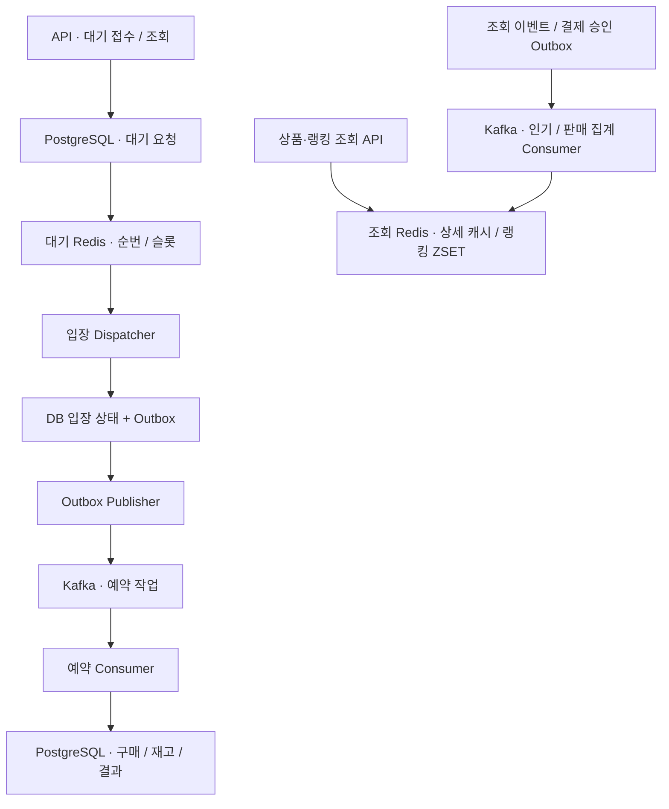

# 한정 상품 플래시세일 구현 계획

단계별 작업·리뷰·commit/push·검토 대기 규칙은 [AGENTS.md](../../AGENTS.md)를 따른다. 다음 단계는 사용자의 시작 요청 이후 진행한다.

**목표:** 5,000명 유입을 가정한 한정 상품 판매에서 Redis ZSET, Kafka, 캐시·랭킹, 장애 복구와 재현 가능한 성능 평가를 학습한다.

**구조:** 기존 업무 모듈과 단일 PostgreSQL을 유지한다. ZSET은 입장 순서·슬롯, Kafka는 작업 전달·재소비, PostgreSQL은 업무 상태, 조회용 Redis는 상품 캐시·랭킹을 맡는다. API와 Worker는 같은 업무 코드를 사용하는 별도 실행 구성으로 확장한다.

**기술:** Java 17, Spring Boot 3.5.16, Spring Modulith 1.4.12, PostgreSQL 17, Redis 7, Kafka, k6, Micrometer·Prometheus·Grafana. 새 제품의 patch 버전과 image digest는 해당 단계 시작 시 확인해 고정하고 실행 manifest에 기록한다.

**1단계 스펙:** [관측과 재현 가능한 기준선](../archive/specs/2026-10-15-stage-1-observability-baseline.md). 이후 단계는 시작 요청 후 직전 결과를 검토하고 해당 단계 스펙을 확정한다.

작성일: 2026-10-15. 이 문서는 제품 범위·학습 요구·단계별 인수 기준을 소유한다. 구현된 계약은 [아키텍처](../architecture/README.md), 진행 상태와 다음 행동은 [로드맵](roadmap.md)이 소유한다.

## 1. 확정한 제품 범위와 학습 목표

UI 없는 한정 상품 플래시세일 API를 만든다. 판매 생성·오픈, 구매 대기·순번 조회, 비동기 예약, 모의 결제·취소·만료, 상품 조회와 인기순·판매순을 제공한다. Kafka·Outbox·캐시·랭킹은 학습 목적의 **필수 범위**다. 성능 병목이 확인되어야만 도입하는 후보로 두지 않는다.

| 학습 목표 | 설명할 수 있어야 할 내용 | 확인할 증거 |
|---|---|---|
| ZSET | score·동점, rank, 원자 claim, 배치 비용, 복구·기간 합산 | 실제 Redis 테스트, 크기·배치별 지연·메모리 비교 |
| Kafka | key·partition·group·offset, 재소비·rebalance·복제 | 분산/집중 부하, 종료 지점별 중복·유실·lag 기록 |
| 캐시·랭킹 | TTL·무효화·stampede, 집계 멱등성·재구성 | cold/warm 비교, 원장과 순위 점수 대조 |
| 내결함성 | 장애 중 수락/거부 정책, 복구와 업무 효과 단일 적용 | 장애 시각·미처리 작업·복구 시간·최종 DB 검증 |
| 부하 평가 | iteration/RPS/사용자 수 구분, 병목과 발생기 한계 | 원본·manifest·지표·최종 결과가 연결된 보고서 |

장바구니·배송·쿠폰·좌석 선택·실제 PG 연동은 이번 범위에 넣지 않는다. 실사용자 인증과 DB 자동 failover는 별도 확장 주제로 남긴다. 기존 local/test 헤더 인증은 격리된 학습 환경에서 사용한다.

## 2. 전체 업무 계약

- 회원당 판매 상품 1개 구매. 판매는 `DRAFT → OPEN → CLOSED`, 구매는 `PENDING_PAYMENT → PAID / CANCELLED / EXPIRED`를 유지한다.
- 구매 예약 시 결제 대기 시간은 기존 5분을 유지한다. 결제 실패는 예약을 유지하고 취소·만료는 재고를 반환한다.
- 수락된 구매 대기 요청은 DB에 영속화되어 최종 상태나 추적 가능한 처리 실패로 귀결되어야 한다. 무제한 자동 재시도나 조용한 폐기는 허용하지 않는다.
- 최종 플래시세일 경로는 대기 API를 사용한다. 직접 예약은 비교용 baseline 실행 구성에서만 허용한다. 기본 노출 제한 방식은 2단계에서 정한다.
- 입장 대상은 서버가 부여한 순번 기준으로 선택한다. 병렬 처리의 구매 성공 순서까지 FIFO로 보장하지 않는다. 순번·복구 계약은 2단계에서 고정한다.
- Kafka 재전달은 허용하되 구매·결제·재고·판매 집계의 업무 효과는 중복 적용하지 않는다. Consumer의 DB 커밋 후 offset 저장 전 중단을 필수 검증한다.
- DB·Redis·Kafka에 걸친 원자 커밋을 가정하지 않는다. 각 경계에 Outbox, 멱등 처리와 복구 기준을 둔다.

### 랭킹 계약

랭킹 단위는 `saleProductId`, 집계 날짜는 이벤트 발생 시각의 `Asia/Seoul` 날짜다.

| 조회 | 점수 | 포함·제외 규칙 |
|---|---|---|
| 오늘 인기순 | 인증 회원의 상품 상세 성공 조회 수, 회원·상품·날짜별 1회 | 목록 조회·404 제외, 상품 캐시 hit 포함 |
| 오늘 판매순 | 결제 승인 수량 | 예약·실패·승인 재전달 제외 |
| 최근 7일 순위 | 오늘을 포함한 한국 시간 날짜 7개의 합 | 정확한 rolling 168시간으로 표현하지 않음 |

판매 순위는 DB 결제 기록/내구성 있는 집계에서 재구성한다. 인기 집계는 상품 조회 가용성을 우선하며 누락·지연을 계측한다. 인기 복원의 이벤트 보존 기간, 동점 규칙, 판매 종료 상품 포함 여부, 조회 TOP N·갱신 지연은 5단계 시작 시 확정한다. 조회 응답은 집계 기준 시각을 제공한다.

## 3. 목표 부하와 합격 기준

| 시나리오 | 최종 목표 | 해석 |
|---|---|---|
| 집중 진입 | 회원 5,000명·상품 1개·재고 500개, 10초간 500 iteration/s | iteration당 진입 1회, 키 발급은 준비 구간 |
| 대기 조회 | 최대 2,500 request/s | 5,000명이 2초마다 조회하는 상한을 별도 재현 |
| 분산 판매·조회 | 판매 상품 100개, 인기 상품 10개에 조회 80% | seed와 배분 규칙을 기록, Kafka key 편향·캐시 효과 비교 |
| 순간 폭주 | 1초 동안 5,000개 진입 목표 | 정상 부하와 분리, 발생기 자원·drop·거부·회복 기록 |
| 지속 부하 | 합의한 정상 유입률로 30분 | 메모리, lag, 연결·스레드 풀, 미처리 누적 관찰 |

**정확성 합격 기준:** 초과 판매·중복 업무 효과·추적되지 않는 수락 요청 각각 0건. 모든 단계에서 재고의 `available + reserved + sold = initial`을 확인한다. 취소·만료 없는 집중 예약 실험은 최종 `RESERVED=500`, `SOLD_OUT=4500`, 활성 대기·FAILED=0을 기대한다. 혼합 결제 실험은 별도 fixture와 상태별 기대값을 사용한다.

**최종 성능 목표안:** 상품/대기 조회 p95 200ms, 접수 p95 500ms, 접수부터 최종 대기 결과까지 p95 60초. p99도 기록한다. 이는 현재 달성값이 아니며 1단계에서 장비·자원 제한을 기록한 뒤 검토한다. 목표 변경은 결과를 본 뒤 기존 실패를 지우는 방식으로 하지 않고 새 revision의 평가 조건으로 남긴다.

정상 목표에서 수락률·처리 결과를 함께 검증한다. 품절 409는 예상 업무 결과로 분류하되 다른 409를 품절로 집계하지 않는다. 과부하의 429·503은 정상 목표 성공으로 계산하지 않는다. k6의 dropped iterations와 서버 거부·오류를 구분한다.

## 4. 목표 처리 구성

아래는 **구현 목표의 흐름**이며 현재 배포 그림이 아니다. 실제 현재 구성은 [C4](../architecture/README.md)를 따른다.

업무 모듈을 유지하며 기술 이름의 `kafka`·`cache` 업무 모듈을 추가하지 않는다. 인프라 어댑터는 소유 업무 모듈에 둔다. 랭킹이 독립적으로 소유할 상태·정책을 갖는지 검토해 5단계에서 `sale` 내부 조회 책임 또는 `ranking` 업무 모듈 중 결정하고 공개 API·이벤트만 연결한다.

대기 Redis와 조회 Redis는 eviction·메모리·복구 정책을 분리한다. Kafka 학습 구성은 일반 Consumer Group을 기준으로 한다. key=`saleProductId`의 집중·분산 상황과 bucket 분산의 순서 비용을 비교한다. Broker 장애 실험은 3개 Broker·복제 3·`min.insync.replicas=2`·`acks=all`을 기준안으로 하며 실제 버전·KRaft 구성은 3단계에서 확정한다. 같은 호스트의 프로세스 장애와 호스트 장애를 구분한다.

### 입력·출력과 영속성 경계

업무 모듈의 입력 Adapter·Port·UseCase·Service·Domain Repository·외부 출력 Port 배치는 [현재 모듈 설계](../architecture/module-boundaries.md#레이어-구조)를 따른다. 향후 Kafka record/ack·Redis 명령 등 기술 타입을 Application 업무 계약에 전달하지 않는다. Consumer의 ack/offset 처리와 업무 멱등성은 다른 책임으로 검증한다.

## 5. 단계별 산출물과 검토 지점

각 단계는 **구현·검증·측정 결과를 독립적으로 검토할 수 있는 단위**다. 최종 목표가 축소되는 순서가 아니라 학습 결과를 확인하는 순서다.

| 단계 | 구현 산출물 | 학습·인수 증거 | 시작 전에 논의할 사항 |
|---|---|---|---|
| 1. 관측·재현 기준선 | Actuator/Prometheus/Grafana, 공통 부하 시나리오, fixture·manifest·SQL 검증 | 같은 조건의 직접/대기 기준선과 원본 연결, 정확성 검증 | 장비·자원, 실행 도구 버전, 성능 목표 검토 |
| 2. ZSET 대기 정합성·입구 보호 | 입력 Scheduler/업무 Worker 책임 분리, 순번 유실/동점 커서 복구, DB 조건부 claim·처리 시도 식별, 수용량·요청 제한, 직접 경로 제한 | Redis 유실·오래 실행 중 복구·중복 claim·배치 경계 테스트, ZSET 크기/claim 배치 비교 | 순번 원장·할당, lease/fencing, 429/503, 전역/상품 슬롯과 공정성 |
| 3. Kafka·Outbox 예약 전달 | 입장 상태+Outbox, Publisher, Consumer, API/Worker 실행 역할 분리 | 전달 경계별 종료·재소비, 동일 업무 효과 1회, lag·partition 분포 | 이벤트 envelope·version·key·partition 수, offset·retry/DLT·Publisher 순서 |
| 4. 상품 조회 캐시 | 별도 조회 Redis, 상세/목록 캐시, TTL·무효화·동시 miss 제어 | cold/warm·일괄 조회·캐시 유실·갱신 지연 비교 | 캐시 대상·key·TTL·허용 stale·eviction·상품 변경 계약 |
| 5. 인기·판매 랭킹 | 조회/결제 이벤트 집계, 일별·7일 ZSET, TOP N 조회·상품 캐시 결합 | 중복·자정·late event·캐시 hit 집계·판매 점수 재구성 | 모듈 소유권·event 보존·동점·필터·갱신 SLO·인기 누락 허용 |
| 6. 다중 프로세스·장애 복구 | API/Worker 복수 인스턴스, Broker 복제, 장애 주입·재처리 절차 | Consumer/Broker/Redis/캐시/DB 중단의 수락 정책·복구 시간·수량 보존 | 토폴로지·자원 상한·장애 시간·복구 목표·재처리 운영 API |
| 7. 종합 부하·학습 정리 | 집중/분산/조회/폭주/지속 시나리오, 최적화 전후 보고서 | 5,000명 목표 평가, 병목별 원인·변경·비용·미달 근거 | 비교 조건·목표 고정·실험 순서·원본 보존 위치 |

2단계에서는 장시간 실행 중인 작업과 복구가 경합해도 이전 시도가 새 시도의 상태·슬롯을 덮어쓰지 않도록 검증한다. Kafka 도입 후에는 전달 대기와 실행 중 작업을 모두 수용량에 포함하고 Outbox/lag 증가 시 입장 속도를 제한한다. 전체 순서와 파티션 내 순서, 발행 순서를 같은 것으로 간주하지 않는다.

6단계에서 DB 장애는 성공 오응답 금지·업무 원자성·복구 후 재시도로 다룬다. PostgreSQL 자동 failover와 실제 결제 공급자 장애는 이번 학습 완료의 전제로 두지 않는다.

## 6. 단계 시작과 검토

단계 시작 시 [로드맵](roadmap.md)의 직전 결과·미완료 항목과 위 표의 미결정 계약을 확인한다. 동작·비용·실험 해석에 영향을 주는 사항은 논의 후 구현하며 이미 합의한 사항은 반복 질문하지 않는다. 상세 설계가 필요한 규모의 단계에만 스펙을 작성하고 작은 수정은 기존 문서를 갱신한다.

일반 단계는 업무·실패 조건의 단위·통합 검증으로 확인한다. 5,000건 부하는 성능 비교가 필요한 변경과 최종 종합 평가에 집중하며 매 단계 반복하지 않는다. 정확성 검증과 성능 목표 달성은 구분한다. 미구현 목표를 현재 Architecture에 반영하지 않는다.

완료한 1·2단계의 실행 작업 목록은 [당시 계획](https://github.com/DevelopHeon/limited-ticketing/blob/8f568dda02af26915745e0a28617d9978529bd1f/docs/plans/2026-10-15-flash-sale-implementation-plan.md)에 남아 있다. 이 문서는 제품 범위·학습 목표·인수 기준을 유지하며 세부 작업 목록과 진행 상태를 중복 관리하지 않는다.
