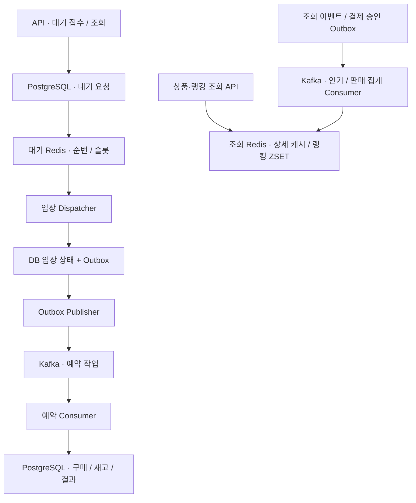

# 한정 상품 플래시세일 구현 계획

> 실행자는 `superpowers:executing-plans`에 따라 **사용자가 시작을 요청한 단계 하나만** 진행한다. 단계 완료 후 검증·한국어 commit/push·결과 인계를 하고 검토 대기로 전환한다. 다음 단계 자동 시작은 금지한다. 작업 위치·환경은 [개발 안내](../development/README.md#작업-위치와-결과)를 따른다.

**목표:** 5,000명 유입을 가정한 한정 상품 판매에서 Redis ZSET, Kafka, 캐시·랭킹, 장애 복구와 재현 가능한 성능 평가를 학습한다.

**구조:** 기존 업무 모듈과 단일 PostgreSQL을 유지한다. ZSET은 입장 순서·슬롯, Kafka는 작업 전달·재소비, PostgreSQL은 업무 상태, 조회용 Redis는 상품 캐시·랭킹을 맡는다. API와 Worker는 같은 업무 코드를 사용하는 별도 실행 구성으로 확장한다.

**기술:** Java 17, Spring Boot 3.5.16, Spring Modulith 1.4.12, PostgreSQL 17, Redis 7, Kafka, k6, Micrometer·Prometheus·Grafana. 새 제품의 patch 버전과 image digest는 해당 단계 시작 시 확인해 고정하고 실행 manifest에 기록한다.

**1단계 스펙:** [관측과 재현 가능한 기준선](../archive/specs/2026-10-15-stage-1-observability-baseline.md). 이후 단계는 시작 요청 후 직전 결과를 검토하고 해당 단계 스펙을 확정한다.

작성일: 2026-10-15. 기준 revision: `0b723512e2bf5c28ba6c80a7173f4e55d8efa00e`. **1단계 실행 인수 완료·검토 대기다. [결과](../evaluations/load-testing/2026-10-15-stage-1-baseline.md)를 검토하고 2단계는 별도 시작 요청 뒤 진행한다.** 현재 계약은 [아키텍처](../architecture/README.md), 진행 상태는 [로드맵](roadmap.md)이 소유한다.

## 1. 확정한 제품 범위와 학습 목표

UI 없는 한정 상품 플래시세일 API를 만든다. 판매 생성·오픈, 구매 대기·순번 조회, 비동기 예약, 모의 결제·취소·만료, 상품 조회와 인기순·판매순을 제공한다. Kafka·Outbox·캐시·랭킹은 학습 목적의 **필수 범위**다. 성능 병목이 확인되어야만 도입하는 후보로 두지 않는다.

| 학습 목표 | 설명할 수 있어야 할 내용 | 확인할 증거 |
|---|---|---|
| ZSET | score·동점, rank, 원자 claim, 배치 비용, 복구·기간 합산 | 실제 Redis 테스트, 크기·배치별 지연·메모리 비교 |
| Kafka | key·partition·group·offset, 재소비·rebalance·복제 | 분산/집중 부하, 종료 지점별 중복·유실·lag 기록 |
| 캐시·랭킹 | TTL·무효화·stampede, 집계 멱등성·재구성 | cold/warm 비교, 원장과 순위 점수 대조 |
| 내결함성 | 장애 중 수락/거부 정책, 복구와 업무 효과 단일 적용 | 장애 시각·미처리 작업·복구 시간·최종 DB 검증 |
| 부하 평가 | iteration/RPS/사용자 수 구분, 병목과 발생기 한계 | 원본·manifest·지표·최종 결과가 연결된 보고서 |

장바구니·배송·쿠폰·좌석 선택·실제 PG 연동은 이번 범위에 넣지 않는다. 실사용자 인증과 DB 자동 failover는 별도 확장 주제로 남긴다. 기존 local/test 헤더 인증은 격리된 학습 환경에서 사용한다.

## 2. 전체 업무 계약

- 회원당 판매 상품 1개 구매. 판매는 `DRAFT → OPEN → CLOSED`, 구매는 `PENDING_PAYMENT → PAID / CANCELLED / EXPIRED`를 유지한다.
- 구매 예약 시 결제 대기 시간은 기존 5분을 유지한다. 결제 실패는 예약을 유지하고 취소·만료는 재고를 반환한다.
- 수락된 구매 대기 요청은 DB에 영속화되어 최종 상태나 추적 가능한 처리 실패로 귀결되어야 한다. 무제한 자동 재시도나 조용한 폐기는 허용하지 않는다.
- 최종 플래시세일 경로는 대기 API를 사용한다. 직접 예약은 비교용 baseline 실행 구성에서만 허용한다. 기본 노출 제한 방식은 2단계에서 정한다.
- 입장 대상은 서버가 부여한 순번 기준으로 선택한다. 병렬 처리의 구매 성공 순서까지 FIFO로 보장하지 않는다. 순번·복구 계약은 2단계에서 고정한다.
- Kafka 재전달은 허용하되 구매·결제·재고·판매 집계의 업무 효과는 중복 적용하지 않는다. Consumer의 DB 커밋 후 offset 저장 전 중단을 필수 검증한다.
- DB·Redis·Kafka에 걸친 원자 커밋을 가정하지 않는다. 각 경계에 Outbox, 멱등 처리와 복구 기준을 둔다.

### 랭킹 계약

랭킹 단위는 `saleProductId`, 집계 날짜는 이벤트 발생 시각의 `Asia/Seoul` 날짜다.

| 조회 | 점수 | 포함·제외 규칙 |
|---|---|---|
| 오늘 인기순 | 인증 회원의 상품 상세 성공 조회 수, 회원·상품·날짜별 1회 | 목록 조회·404 제외, 상품 캐시 hit 포함 |
| 오늘 판매순 | 결제 승인 수량 | 예약·실패·승인 재전달 제외 |
| 최근 7일 순위 | 오늘을 포함한 한국 시간 날짜 7개의 합 | 정확한 rolling 168시간으로 표현하지 않음 |

판매 순위는 DB 결제 기록/내구성 있는 집계에서 재구성한다. 인기 집계는 상품 조회 가용성을 우선하며 누락·지연을 계측한다. 인기 복원의 이벤트 보존 기간, 동점 규칙, 판매 종료 상품 포함 여부, 조회 TOP N·갱신 지연은 5단계 시작 시 확정한다. 조회 응답은 집계 기준 시각을 제공한다.

## 3. 목표 부하와 합격 기준

| 시나리오 | 최종 목표 | 해석 |
|---|---|---|
| 집중 진입 | 회원 5,000명·상품 1개·재고 500개, 10초간 500 iteration/s | iteration당 진입 1회, 키 발급은 준비 구간 |
| 대기 조회 | 최대 2,500 request/s | 5,000명이 2초마다 조회하는 상한을 별도 재현 |
| 분산 판매·조회 | 판매 상품 100개, 인기 상품 10개에 조회 80% | seed와 배분 규칙을 기록, Kafka key 편향·캐시 효과 비교 |
| 순간 폭주 | 1초 동안 5,000개 진입 목표 | 정상 부하와 분리, 발생기 자원·drop·거부·회복 기록 |
| 지속 부하 | 합의한 정상 유입률로 30분 | 메모리, lag, 연결·스레드 풀, 미처리 누적 관찰 |

**정확성 합격 기준:** 초과 판매·중복 업무 효과·추적되지 않는 수락 요청 각각 0건. 모든 단계에서 재고의 `available + reserved + sold = initial`을 확인한다. 취소·만료 없는 집중 예약 실험은 최종 `RESERVED=500`, `SOLD_OUT=4500`, 활성 대기·FAILED=0을 기대한다. 혼합 결제 실험은 별도 fixture와 상태별 기대값을 사용한다.

**최종 성능 목표안:** 상품/대기 조회 p95 200ms, 접수 p95 500ms, 접수부터 최종 대기 결과까지 p95 60초. p99도 기록한다. 이는 현재 달성값이 아니며 1단계에서 장비·자원 제한을 기록한 뒤 검토한다. 목표 변경은 결과를 본 뒤 기존 실패를 지우는 방식으로 하지 않고 새 revision의 평가 조건으로 남긴다.

정상 목표에서 수락률·처리 결과를 함께 검증한다. 품절 409는 예상 업무 결과로 분류하되 다른 409를 품절로 집계하지 않는다. 과부하의 429·503은 정상 목표 성공으로 계산하지 않는다. k6의 dropped iterations와 서버 거부·오류를 구분한다.

## 4. 목표 처리 구성

아래는 **구현 목표의 흐름**이며 현재 배포 그림이 아니다. 실제 현재 구성은 [C4](../architecture/README.md)를 따른다.



업무 모듈을 유지하며 기술 이름의 `kafka`·`cache` 업무 모듈을 추가하지 않는다. 인프라 어댑터는 소유 업무 모듈에 둔다. 랭킹이 독립적으로 소유할 상태·정책을 갖는지 검토해 5단계에서 `sale` 내부 조회 책임 또는 `ranking` 업무 모듈 중 결정하고 공개 API·이벤트만 연결한다.

대기 Redis와 조회 Redis는 eviction·메모리·복구 정책을 분리한다. Kafka 학습 구성은 일반 Consumer Group을 기준으로 한다. key=`saleProductId`의 집중·분산 상황과 bucket 분산의 순서 비용을 비교한다. Broker 장애 실험은 3개 Broker·복제 3·`min.insync.replicas=2`·`acks=all`을 기준안으로 하며 실제 버전·KRaft 구성은 3단계에서 확정한다. 같은 호스트의 프로세스 장애와 호스트 장애를 구분한다.

### 입력·출력 어댑터 배치 결정

사용자와 합의한 방향: Controller·Kafka Consumer·Scheduler는 `presentation`의 입력 어댑터, Redis ZSET/캐시·Kafka Producer·JPA는 `infrastructure`의 출력 어댑터로 둔다. [ADR 0005](../adr/0005-inbound-outbound-adapters.md)를 따른다.

현재 Scheduler/Worker의 실행 주기는 입력 어댑터로 옮기고, 조회·claim·예약·완료·슬롯 반환의 업무 조율은 Application Service로 분리한다. 입력 어댑터는 입력 Facade만 사용하며 Kafka record/ack 타입·Redis 명령을 Application에 전달하지 않는다. 같은 모듈의 내부 입력 계약을 다른 모듈의 Named Interface로 불필요하게 공개하지 않는다.

이 책임 분리와 ArchUnit 검증 보완은 **2단계**에 포함한다. 3단계 Consumer부터 같은 원칙을 적용한다. 1단계에서는 측정 기준선을 확보하기 위해 기존 Worker를 이동하거나 업무 알고리즘을 바꾸지 않는다.

## 5. 단계별 산출물과 검토 지점

각 단계는 **구현·검증·측정 결과를 독립적으로 검토할 수 있는 단위**다. 최종 목표가 축소되는 순서가 아니라 학습 결과를 확인하는 순서다.

| 단계 | 구현 산출물 | 학습·인수 증거 | 시작 전에 논의할 사항 |
|---|---|---|---|
| 1. 관측·재현 기준선 | Actuator/Prometheus/Grafana, 공통 부하 시나리오, fixture·manifest·SQL 검증 | 같은 조건의 직접/대기 기준선과 원본 연결, 정확성 검증 | 장비·자원, 실행 도구 버전, 성능 목표 검토 |
| 2. ZSET 대기 정합성·입구 보호 | 입력 Scheduler/업무 Worker 책임 분리, 순번 유실/동점 커서 복구, DB 조건부 claim·처리 시도 식별, 수용량·요청 제한, 직접 경로 제한 | Redis 유실·오래 실행 중 복구·중복 claim·배치 경계 테스트, ZSET 크기/claim 배치 비교 | 순번 원장·할당, lease/fencing, 429/503, 전역/상품 슬롯과 공정성 |
| 3. Kafka·Outbox 예약 전달 | 입장 상태+Outbox, Publisher, Consumer, API/Worker 실행 역할 분리 | 전달 경계별 종료·재소비, 동일 업무 효과 1회, lag·partition 분포 | 이벤트 envelope·version·key·partition 수, offset·retry/DLT·Publisher 순서 |
| 4. 상품 조회 캐시 | 별도 조회 Redis, 상세/목록 캐시, TTL·무효화·동시 miss 제어 | cold/warm·일괄 조회·캐시 유실·갱신 지연 비교 | 캐시 대상·key·TTL·허용 stale·eviction·상품 변경 계약 |
| 5. 인기·판매 랭킹 | 조회/결제 이벤트 집계, 일별·7일 ZSET, TOP N 조회·상품 캐시 결합 | 중복·자정·late event·캐시 hit 집계·판매 점수 재구성 | 모듈 소유권·event 보존·동점·필터·갱신 SLO·인기 누락 허용 |
| 6. 다중 프로세스·장애 복구 | API/Worker 복수 인스턴스, Broker 복제, 장애 주입·재처리 절차 | Consumer/Broker/Redis/캐시/DB 중단의 수락 정책·복구 시간·수량 보존 | 토폴로지·자원 상한·장애 시간·복구 목표·재처리 운영 API |
| 7. 종합 부하·학습 정리 | 집중/분산/조회/폭주/지속 시나리오, 최적화 전후 보고서 | 5,000명 목표 평가, 병목별 원인·변경·비용·미달 근거 | 비교 조건·목표 고정·실험 순서·원본 보존 위치 |

2단계에서는 장시간 실행 중인 작업과 복구가 경합해도 이전 시도가 새 시도의 상태·슬롯을 덮어쓰지 않도록 검증한다. Kafka 도입 후에는 전달 대기와 실행 중 작업을 모두 수용량에 포함하고 Outbox/lag 증가 시 입장 속도를 제한한다. 전체 순서와 파티션 내 순서, 발행 순서를 같은 것으로 간주하지 않는다.

6단계에서 DB 장애는 성공 오응답 금지·업무 원자성·복구 후 재시도로 다룬다. PostgreSQL 자동 failover와 실제 결제 공급자 장애는 이번 학습 완료의 전제로 두지 않는다.

## 6. 단계 실행·종료 규칙

1. 사용자가 특정 단계의 시작을 요청하면 현재 HEAD·작업 트리와 직전 단계 commit·보고서·미완료 항목을 확인한다.
2. 위 표의 논의 사항 중 동작·계약·비용·실험 해석을 바꾸는 미결정 항목을 먼저 논의한다. 합의 전 의존하는 구현을 시작하지 않는다. 이미 합의한 사항은 반복 질문하지 않는다.
3. 해당 단계 스펙을 확정하고 그 단계만 구현한다. 한국어 `@DisplayName`, 업무 분기/부수효과 테스트, 기존 아키텍처·코드 규칙을 유지한다.
4. `./gradlew check`와 단계 인수 검증을 실행한다. 일반 단계는 단위·통합·Smoke로 검증하고 5,000건 부하는 성능 비교가 필요한 변경과 최종 종합 평가에 집중한다. 실패를 숨기거나 기준을 낮추지 않는다. 성능 목표 미달은 정확성과 구분해 기록한다.
5. 현재 계약·실행 절차·중요 ADR·평가를 갱신한다. 구현되지 않은 내용을 현재 아키텍처에 완료 상태로 반영하지 않는다.
6. 변경 범위를 확인해 한국어로 commit/push한다. 비 fast-forward나 권한 오류는 원인을 보고하고 force push로 우회하지 않는다. push 성공과 원격 commit을 확인한다.
7. 변경·검증·실측·한계·학습 질문·다음 단계 논의 목록을 인계하고 **검토 대기에서 종료**한다. 성공적인 push나 리뷰 완료만으로 다음 단계가 자동 승인된 것으로 간주하지 않는다. 사용자가 다음 단계 시작을 명확히 요청하면 이미 합의한 범위를 유지하고 필요한 논의부터 진행한다.

단계 상태는 `미착수 → 논의 중 → 구현 중 → 검증 중 → push 완료·검토 대기 → 검토 완료`로 관리한다. 구현 미완료·검증 실패를 push 완료라는 이유로 완료 처리하지 않는다.

본 문서와 1단계 스펙 작성은 기능 구현과 별개의 문서 작업이다. 문서 작성 완료가 1단계 실행 승인을 뜻하지 않는다. 이번 문서 준비 작업도 문서만 한국어 commit/push하고 검토 대기한다. 1단계 구현은 별도 시작 요청 이후 진행한다.

## 7. 1단계 실행 작업

1단계의 값·계약·인수 기준은 [스펙](../archive/specs/2026-10-15-stage-1-observability-baseline.md)이 소유한다. 아래는 완료한 1단계 작업 기록이다. 스펙은 보관 위치로 이동했으며 현재 실행 절차와 결과는 가이드/평가 문서를 따른다.

### 공통 제약

- Java 17·기존 모듈 경계 유지. Application/Domain에 모니터링 프레임워크 의존성을 추가하지 않는다.
- 모든 Java 테스트 클래스·메서드에 한국어 `@DisplayName`을 사용한다. Checkstyle·ArchUnit·Modulith 기준을 임의로 완화하지 않는다.
- 기능 변경은 관측·평가에 필요한 범위로 한정한다. 재고 SQL·순번·Worker 알고리즘·기존 HTTP 업무 계약은 1단계에서 변경하지 않는다.
- 작은 task의 commit을 나누어도 단계 종료 전까지 검증·push·인계한다. push 뒤 다음 단계는 시작하지 않는다.

### 리뷰 집중 항목

1. 인증 없는 지표 노출: 비인증 401·회원 403·관리자 200과 기존 API 정책 유지.
2. 품절이 아닌 409·부하 발생기 drop: 정상 업무 결과로 잘못 집계하지 않음.
3. timeout·중간 오류: 원본·최종 상태·실패 원인을 보존하고 성공 보고 금지.
4. fixture 재사용·동시 실행: 새 입력/출력 경로, 정확한 실행 식별, 이전 상태 비간섭.
5. 대기 처리 시간과 HTTP 접수 시간: 별도 측정하고 프로세스 재시작/관측 누락을 명시.

### Task 1.1 · 관측 가능한 실행 환경

인수 연결: S1-01, S1-02.

**변경:** `build.gradle`, `app/build.gradle`, `app/src/main/resources/application.yml`, `app/src/main/java/com/example/limitedticketing/configuration/security/SecurityConfig.java`, `compose.yaml`, `compose.baseline.yaml`.

**생성:** `observability/prometheus/prometheus.yml`, `observability/grafana/provisioning/datasources/prometheus.yml`, `observability/grafana/provisioning/dashboards/dashboards.yml`, `observability/grafana/dashboards/flash-sale-baseline.json`, `app/src/test/java/com/example/limitedticketing/integration/observability/ObservabilityIntegrationTest.java`.

**계약:** 기존 `local/test` 관리자 인증으로 `/actuator/prometheus`를 읽는다. `observability` Compose profile이 호스트 앱을 scrape한다. 상세 설정은 스펙 §3을 따른다.

- [x] 지표 접근 제어·요청 계측을 검증하는 통합 테스트를 먼저 작성한다. 정확성 실패 요청도 HTTP 결과로 계측하고 회원별 label은 만들지 않는다.
- [x] 다음 테스트가 의도한 이유로 실패하는지 확인한다.

```bash
./gradlew :app:test --tests '*ObservabilityIntegrationTest'
```

- [x] Actuator·Prometheus registry와 접근 정책, Compose profile과 자동 provisioning을 구현한다.
- [x] 같은 테스트를 통과시키고 Compose profile 기동·scrape UP·대시보드 데이터 표시를 확인한다. 관측 구성 유무에 따른 Smoke의 업무 결과가 같아야 한다.

### Task 1.2 · 같은 유입 모델의 직접/대기 평가 도구

인수 연결: S1-03, S1-04, S1-05, S1-06.

**생성:** `load-test/k6/baseline_results.py`, `load-test/k6/baseline_environment.py`, `load-test/k6/lib/baseline-contract.mjs`, `load-test/k6/baseline-contract.test.mjs`, `load-test/k6/flash-sale-baseline.js`, `load-test/k6/sql/prepare-flash-sale.sql`, `load-test/k6/sql/verify-flash-sale.sql`, `load-test/k6/run-baseline.py`, `load-test/k6/test_run_baseline.py`.

**기존 유지:** `sale-open.js`, `waiting-room.js`와 기존 SQL은 이전 기록의 실행 계약으로 유지한다. 새로운 공통 시나리오는 기존 업무 API를 호출한다.

**입출력:** `run-baseline.py --flow {direct,waiting} --scenario {smoke,baseline,observe-5000} --base-url URL --output-root PATH` → 고유 run 디렉터리의 manifest·fixture·summary·검증·샘플·원본. Python 3 표준 라이브러리로 `psql`, `k6`, Docker CLI를 인자 배열로 호출하고 셸 문자열 보간을 사용하지 않는다.

- [x] 실제 k6가 사용하는 응답 분류를 Node `node:test`로 검증하고, 표준 라이브러리 `unittest`로 `test_existing_run_is_not_overwritten`, `test_unexpected_responses_fail_workload`, `test_dropped_iterations_fail_workload`, `test_quantity_mismatch_fails_integrity`, `test_timeout_preserves_partial_artifacts`를 작성해 각각 재실행 덮어쓰기 방지, 품절 외 409 분류, drop, SQL 수량 불일치, timeout 결과 보존을 검증한다. Python 테스트는 한국어 설명 docstring, Node 테스트는 한국어 테스트 이름을 둔다.
- [x] `python3 -m unittest discover -s load-test/k6 -p test_run_baseline.py`로 테스트가 의도한 이유로 실패하는지 확인하고 fixture·검증 SQL·k6 시나리오·실행 조율을 구현한다. 외부 프로세스 호출은 대체해 실패 분기를 검증하고 실제 Smoke로 연결을 확인한다.
- [x] 같은 유입 모델·초기 수량·Worker 설정을 사용하는 direct/waiting Smoke를 각각 실행한다. 키 발급은 측정 전 완료하고 다른 fixture로 warmup한다.
- [x] 의도적으로 잘못된 기대 재고와 불완전 summary를 입력했을 때 도구가 실패를 보고하고 원본을 남기는지 확인한다. 무의미한 DTO/설정 접근자 테스트는 만들지 않는다.

### Task 1.3 · 기준선 기록과 단계 종료

인수 연결: S1-07, S1-08, S1-09.

**갱신:** `docs/performance/load-testing.md`, `docs/development/README.md`, `docs/development/testing.md`, `docs/architecture/deployment.md`, `docs/plans/roadmap.md`.

**평가 생성:** `docs/evaluations/load-testing/<실제 정리일>-stage-1-baseline.md`. raw artifact는 Git 제외 경로에 보존하고 hash·보존 위치를 연결한다.

- [x] `./gradlew check`와 Python 테스트를 통과시킨다.
- [x] fresh fixture로 baseline을 direct/waiting 각각 3회, observe-5000을 각각 1회 실행한다. 장비가 부족하면 관측 실패·자원 상한을 기록하고 5,000명 달성을 주장하지 않는다.
- [x] HTTP 지연·최종 업무 결과·대기 완료 시간·DB 락·연결 대기·JVM·관측 overhead를 해석한다. 서로 다른 실험의 percentile을 합쳐 하나의 percentile로 만들지 않는다.
- [x] 1단계 인수 기준과 알려진 한계, 2단계 논의 사항을 보고서와 로드맵에 반영한다.
- [x] 한국어 commit/push 후 원격 반영을 확인하고 **검토 대기에서 종료**한다.

### 실행 중 확인한 조정

- 1단계 측정 당시에는 사용자 선택에 따라 현재 Mac의 별도 앱 18081·DB 15432·Redis 16379를 사용했다. 이후 사용자 요청으로 기존 checkout의 master와 기존 로컬 앱·DB·Redis에서 작업하도록 변경했다. 측정 원본도 기존 프로젝트로 복사했으며 당시 조건은 보존한다.
- k6 2.1.0은 999ms를 거부하고 정확한 1초는 경계에서 11번째 iteration을 시작했다. Smoke를 2초·5/s로 조정하고 종료 경계를 마지막 목표 시작과 다음 시작의 중간(`duration*1000 - 500/rate` ms)으로 둔다. 1ms만 줄인 Smoke에서도 타이머 경합으로 추가 iteration이 관찰됐기 때문이다. 실제 iterations와 목표 건수를 대조하며 결과를 보정하지 않는다.
- 응답 분류는 k6가 실행하는 JS를 직접 검증하고, Python은 원본 보존·DB 정합성과 실행 조율을 검증한다.
- 실제 Servlet 계측을 확인하도록 지표 통합 테스트는 MockMvc 대신 임의 포트의 TestRestTemplate을 사용한다.

## 8. 다음 단계에서 확인할 질문

1단계 시작 시 장비/컨테이너 자원 상한과 도구 버전, 기준선 실행 환경을 먼저 확인한다. 1단계 결과를 받은 뒤 2단계의 순번 내구성·lease/fencing·복구 커서·과부하 정책을 논의한다. 이후 단계의 상세 인터페이스를 지금 추정해 코드로 만들지 않는다.

## 9. 2단계 실행 계획 · 2026-10-16

스펙: [대기 정합성과 입구 보호](../archive/specs/2026-10-16-stage-2-queue-consistency.md). 실행 방식은 기존처럼 직접 구현·최종 전체 리뷰 1회다. 기존 master와 로컬 환경에서 작업한다.

### Task 2.1 · 입력 어댑터와 실행 버퍼 분리

- [x] `LayeringArchitectureTests`에 Scheduled 메서드의 presentation 위치 검사를 추가하고 기존 두 Scheduler에서 실패를 확인한다.
- [x] `ReservationQueueWorker`의 조율을 `application/command/service/ReservationQueueDispatchService`로 이동한다. `presentation/scheduler/ReservationQueueScheduler`는 `application/port/in/worker/ReservationQueueWorkerFacade`만 호출한다.
- [x] 구매 만료 Scheduler도 presentation으로 이동하고 내부 `PurchaseExpirationFacade`를 사용한다.
- [x] 출력 `ReservationQueueTaskExecutor`와 infrastructure 구현으로 전역 실행 가능 수만 dispatch하고 큐 버퍼를 없앤다. 실행 거부는 재대기한다.
- [x] `./gradlew :app:test --tests '*LayeringArchitectureTests' --tests '*ModularityTests'`와 기존 대기/구매 테스트를 통과시킨다.

### Task 2.2 · 순번·claim·복구·입구 보호

- [x] Redis 유실 순번·동점 cursor·동시 claim·구 토큰·실행 중 lease 복구·수용량·429/503·직접 HTTP 차단을 실제 DB/Redis/HTTP 테스트로 먼저 재현한다.
- [x] 새 Flyway migration으로 상품별 순번 원장과 처리 토큰/lease, 복구 index를 추가한다. 기존 migration은 수정하지 않는다.
- [x] `QueueSequenceGenerator`의 PostgreSQL 구현, 상품별 정책 잠금과 조건부 claim, 행 잠금+토큰 기반 처리/복구를 구현한다.
- [x] Redis claim/release/requeue/복원 Lua를 module resource에 두고 운영 코드와 실험 도구가 같은 원본을 사용하게 한다.
- [x] 신규 진입 rate guard·수용량 10,000·429/503·Retry-After를 구현한다. 같은 키의 멱등 응답은 먼저 반환한다.
- [x] 직접 Controller는 baseline profile에서만 활성화하고 테스트의 비교 경로는 profile을 명시한다.
- [x] 각 실패 테스트의 GREEN과 `./gradlew check`, 부하 도구·관측 비밀값 테스트를 확인한다.

### Task 2.3 · 실험과 단계 종료

- [x] 기존 환경에서 작은 Smoke와 실제 Lua의 크기/배치 실험을 수행한다. 실패 원본도 보존한다. 사용자 요청에 따라 단계마다 5,000건 부하를 반복하지 않으며 성능 비교와 최종 종합 평가에서만 필요에 맞춰 실행한다.
- [x] HTTP 접수·결과 완료·처리 실행·연결/락 대기·ZSET 비용을 구분하고 한계와 미달을 보고한다.
- [x] 현재 API·복구·계층·실행 문서와 ADR, 평가·로드맵을 갱신한다. 최종 전체 리뷰의 중요 문제는 회귀 테스트로 수정한다.
- [x] 한국어 commit/push 후 원격 반영을 확인하고 2단계 검토 대기에서 종료한다.
