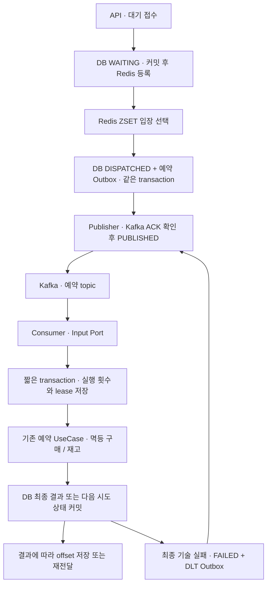

# 3단계 스펙 · Kafka와 Outbox를 통한 예약 작업 전달

기준 revision: `ac2487a86b6ff2ca9e0acbb74628a0ea627fd9ac`. 제품 범위는 [전체 계획](2026-10-15-flash-sale-implementation-plan.md), 진행 상태와 미결정 사항은 [로드맵](roadmap.md)이 소유한다. 이 문서는 이번 단계의 처리 계약·설계안·인수 조건을 설명한다. 2026-10-19 사용자가 서면 스펙과 구현 진행을 승인했다.

## 1. 목적과 범위

Redis ZSET의 입장 선택과 실제 예약 실행 사이를 Kafka로 연결한다. DB 상태 변경 후 프로세스가 종료되더라도 전달할 작업이 남아야 하며, 중복 발행·재소비가 구매와 재고에 중복 효과를 만들지 않아야 한다. partition·offset·consumer group·복제와 장애 복구를 직접 확인한다. Kafka 도입 자체를 지연 개선의 근거로 사용하지 않는다.

포함:

- 입장 상태와 Outbox의 원자 저장, polling Publisher, Kafka Consumer.
- 전달 대기와 실행 상태 분리, 지속되는 실행 횟수·시도 토큰·lease.
- 업무 멱등성, 기술적 실패 3회 후 결과 복원 또는 FAILED·DLT 기록, 명시적 재처리.
- API/Worker 실행 역할, 기존 Compose project 내 Kafka 구성, 필요한 관측과 작은 장애·재소비 실험.

제외: 상품 캐시·랭킹, 실제 PG·운영 인증, DB 자동 failover, 다중 앱의 처리량 확장 평가, 매 단계 반복하는 5,000건 부하. Kafka 이름의 새 업무 모듈과 Redis/DB의 별도 운영 인스턴스는 만들지 않는다.

## 2. 합의 사항과 검토할 기준안

2026-10-19 사용자 답변으로 확정한 두 계약:

1. 내부에 DISPATCHED를 추가하되 기존 조회 API는 PROCESSING으로 표시한다.
2. 기술적 예약 실행 오류는 최초 시도를 포함해 총 3회까지 시도한다. 소진 시 이미 생성된 구매를 조회해 결과를 복원하고, 구매가 없다고 확인되면 FAILED와 DLT로 추적한다. 자동 업무 재처리는 종료하며 이후 명시적으로 재처리한다.

아래 구성·운영 수치는 이 스펙의 검토 기준안이다. 동작을 바꾸는 수정은 문서와 인수 조건에 먼저 반영한다.

| 항목 | 기준안 |
|---|---|
| Broker | `apache/kafka:4.2.2`, KRaft combined Broker/Controller 3개, 각 영속 volume |
| 의존성 | 기존 Boot 3.5.16 BOM의 Spring Kafka 3.3.16·Kafka client 3.9.2·Testcontainers 1.21.4 사용. Boot 전체 업그레이드 없음 |
| 예약 topic | `limited-ticketing.purchasewaiting.reservation.v1` |
| DLT | `limited-ticketing.purchasewaiting.reservation.v1-dlt`, 자동 소비·재발행 없음 |
| partition·복제 | 두 topic 각각 partition 6개, replication factor 3, `min.insync.replicas=2` |
| key·group | key=`saleProductId`의 10진 문자열, group=`purchasewaiting-reservation-v1` |
| Producer | `acks=all`, idempotence 활성화, `max.in.flight.requests.per.connection=5` |
| Consumer | record listener, concurrency 3, `enable.auto.commit=false`, `MANUAL_IMMEDIATE`, `max.poll.records=1` |
| 보존 | 예약 topic 7일, DLT 14일. PENDING Outbox는 Kafka retention과 무관하게 삭제하지 않음 |
| 실행 상한 | 기존 기본값 유지: 상품별 입장 중 10개, 전체 입장 중 10개. 입장 중은 DISPATCHED+PROCESSING 합계 |
| 시간 | 실제 실행 lease 30초, 실행 재시도 간격 1초, 전달 대기 60초부터 경고 |
| Publisher | 100ms polling, 최대 10개 선택, 확인된 발행만 PUBLISHED. 발행 실패 backoff는 1·2·4·8·16·30초 후 30초 상한 |

Producer idempotence는 Outbox의 논리적 중복 발행까지 제거하지 않는다. 전달 보장은 at-least-once이며 DB의 업무 멱등성과 시도 검사가 필요하다.

같은 상품 key는 한 partition으로 모인다. concurrency를 늘려도 그 상품의 Kafka 소비 병렬성이 늘어난다고 가정하지 않는다. 이번에는 상품별 key를 유지하고 집중 key와 여러 상품 key의 분포를 비교한다. bucket key를 통한 상품 내 병렬화는 측정 후 별도 판단한다.

이미지 digest와 arm64 지원, client/Broker 연결은 구현 시 실제 registry·의존성·기동 검사로 확인해 실행 기록에 남긴다. 최신 tag를 사용하지 않는다.

## 3. 목표 흐름과 트랜잭션

1. 접수는 기존 DB 원장·멱등 키·Redis 장애 전후 정책을 유지한다. Kafka 발행을 HTTP 202의 전제로 넣지 않는다. Broker 장애 중에도 이미 수락된 요청은 DB에 남는다. 상품별 미완료 10,000건·신규 진입 초당 1회·429/503 계약도 유지한다.
2. Dispatcher는 Redis claim 후 DB의 상품별·전체 입장 상한을 잠금과 함께 확인한다. WAITING→DISPATCHED와 예약 Outbox 삽입을 같은 DB transaction으로 커밋한다. 실패하면 둘 다 롤백한다. DB가 입장을 거절하면 해당 Redis 시도를 token 검사로 반환한다.
3. 입장 상한은 여러 Dispatcher가 같은 값을 읽고 동시에 초과하지 않도록 DB의 일관된 잠금 순서로 보호한다. Kafka 전달 대기 역시 슬롯을 점유한다. 기존 로컬 Executor의 남은 스레드 수를 Kafka backlog 판정에 사용하지 않는다.
4. Publisher는 Outbox를 잠금·claim하여 발행한다. Kafka ACK 전 PUBLISHED로 저장하지 않는다. ACK 후 DB 갱신 전 종료되면 같은 eventId가 재발행될 수 있다. 잠금을 잡은 발행 구간에는 유한한 send·transaction timeout을 둔다.
5. Consumer는 짧은 시작 transaction에서 현재 시도·상태를 확인하고 실행 횟수와 lease를 먼저 커밋한다. 이후 기존 실행 transaction에서 행 잠금·token·lease를 검사하고 예약한다. 실행 횟수는 업무 롤백이나 Worker 재시작으로 초기화되지 않는다.
6. 기존 구매 REQUIRES_NEW와 구매 요청 키를 통한 멱등성은 유지한다. 구매 커밋 후 대기 결과 저장이 실패할 수 있음을 전제로 한다. DB/Kafka 분산 transaction이나 Kafka exactly-once로 이 경계를 해결했다고 표현하지 않는다.

단일 Publisher의 정상 발행 순서와 partition의 실제 기록 순서는 구분한다. 재발행·복구 시 예전 작업이 뒤에 기록될 수 있으며 전체 상품의 완료 FIFO를 보장하지 않는다. 기존 queueSequence는 입장 선택 기준이다.

## 4. 상태·시도·API 호환성

| 내부 상태 | 의미 | 외부 status | 자동 동작 |
|---|---|---|---|
| WAITING | 아직 입장하지 않음 | WAITING | ZSET 복원·입장 선택 |
| DISPATCHED | 입장 완료, 전달 또는 실행 시작 대기 | PROCESSING | Outbox 발행·Kafka 소비 |
| PROCESSING | 현재 시도가 실제 예약 실행 중 | PROCESSING | token·lease 검사 |
| RESERVED / SOLD_OUT | 예약 결과 확정 | 기존 값 | 중복 전달은 업무 변경 없이 종료 |
| FAILED | 업무 실패 또는 재시도 소진이 확정됨 | FAILED | 기술 실패만 명시적 재처리 가능 |

- 조회·접수 응답의 필드와 기존 status 집합을 유지한다. Facade와 Query PortService 양쪽에서 DISPATCHED를 PROCESSING으로 투영한다. position은 WAITING에만 제공한다.
- `processingStartedAt`은 실제 실행 시작 시각이다. 최초 전달 대기 동안 null일 수 있다. 내부 `dispatchedAt`으로 전달 지연을 별도 관측한다. `completedAt-createdAt`은 전달 대기를 포함한 전체 완료 시간이다.
- countActive, 활성 ID, 판매별 미완료 조회, 정리·보호·지표·SQL 판정에는 DISPATCHED를 포함한다. DISPATCHED를 빠뜨려 수용량을 우회하거나 완료로 오판하지 않는다.
- token은 현재 입장 세대를 식별한다. Kafka event의 eventId·entryId·saleProductId·token이 DB 작업과 일치해야 한다. 외부 메시지의 회원·상품·구매 키를 그대로 믿고 업무를 실행하지 않는다.
- 실행 중 행 잠금은 기존처럼 복구와 경합을 막는다. 오래된 token은 구매를 호출하거나 새 시도의 상태·Redis 슬롯을 변경할 수 없다.
- 전달 대기에는 실행 lease를 시작하지 않는다. Worker 중단으로 Kafka에 쌓인 작업을 30초마다 WAITING으로 되돌리지 않는다. 오래 대기한 작업은 경고·명시적 재전달로 추적한다.

기존 PROCESSING 행은 배포 전에 이전 Worker를 중지한 후 migration한다. 기존 token·lease를 보존하고 최초 실행 1회로 간주한다. 만료된 행은 새 복구 경로로 회수한다. 이미 적용된 V1–V6 migration이나 과거 데이터 원본을 수정하지 않는다.

## 5. 이벤트와 Outbox 계약

예약 메시지 envelope v1:

| 필드 | 타입·의미 |
|---|---|
| eventId | UUID, 저장된 Outbox event의 식별자. 동일 event 재발행 시 유지 |
| eventType | `PurchaseReservationRequested` |
| schemaVersion | 정수 1 |
| occurredAt | UTC Instant 문자열, 입장 transaction 기준 |
| waitingEntryId | UUID, 기존 원장 식별자 |
| saleProductId | 양의 정수, Kafka key와 DB 값 일치 검사 |
| processingToken | UUID, 현재 입장 시도 token |

memberId·구매 요청 키·가격·재고를 복제하지 않는다. Consumer는 원장에서 업무 입력을 읽는다. Topic·record·ack·Kafka 예외는 Adapter와 configuration이 소유하며 Application 계약에 Kafka 타입을 전달하지 않는다.

Outbox는 `eventId`, 작업·종류·token, topic/key/payload, 생성·재발행 가능 시각, 발행 횟수·실패 코드, PENDING/PUBLISHED, 발행 완료 시각을 저장한다. 동일 작업의 같은 종류·token 중복 삽입은 DB 제약으로 방지한다. 발행 성공과 업무 완료를 혼동하지 않는다. 실행 소진의 DLT 알림도 별도 종류의 Outbox로 저장한다.

Aggregate의 상태와 실행 횟수는 Domain Repository가 저장한다. Outbox는 기술적 전달 기록이므로 Application Output Port와 infrastructure persistence 구현을 사용한다. Outbox를 이유로 기존 Aggregate Repository를 Application Port로 다시 옮기지 않는다.

Outbox 영속성은 `PurchaseWaitingOutboxAdapter`와 구체 클래스 `PurchaseWaitingOutboxJdbcRepository`로 나눈다. Adapter는 이벤트 직렬화·topic/key 결정·Port DTO 변환을, JdbcRepository는 JdbcTemplate을 통한 SQL 실행·파라미터 바인딩·행 매핑을 맡는다. Repository는 infrastructure 내부 구현이며 별도 추상 인터페이스를 추가하지 않는다. transaction 경계는 입장·발행 Application Service가 유지한다.

## 6. 실패·재소비·재처리

| 상황 | 처리 | offset |
|---|---|---|
| 예약 성공·품절·확정 업무 오류 | 기존 RESERVED/SOLD_OUT/FAILED 저장 | 커밋 후 저장 |
| 이미 완료된 event·이전 token | 원장을 확인해 부수효과 없이 종료 | 확인 후 저장 |
| 유효한 시도가 실행 중인 중복 | 기존 실행을 침범하지 않음. 종료·lease 복구로 이어지는 DB 원장이 남아야 함 | 그 보장이 있는 중복만 저장 |
| 기술적 실행 오류, 횟수 1·2 | 다음 실행 가능한 상태를 DB에 저장, 같은 업무 키 유지, 1초 후 재전달 | 저장하지 않음 |
| 3회 소진 | 아래 결과 복원 절차 | 복원 또는 FAILED+DLT Outbox 커밋 후 저장 |
| JSON·필수 필드·version·key 불일치 | 업무 입력으로 사용하지 않고 원본·위치·오류를 DLT에 격리 | DLT 발행 확인 후 저장 |
| DB 접근 불가·복원 여부 확인 불가 | 성공/FAILED를 추정하지 않음. 유한한 기술 재시도 후 해당 Consumer 정지·경고 | 저장하지 않음 |
| DLT 발행 실패 | 격리 성공으로 간주하지 않고 Consumer 정지·경고 | 저장하지 않음 |

기술 재시도 소진의 결과 복원:

1. 원장 행을 잠그고 현재 token과 terminal 여부를 재확인한다.
2. purchase의 공개 조회 Port를 통해 원장의 memberId·purchaseRequestKey에 해당하는 기존 구매를 확인한다. 다른 모듈 Domain Repository는 직접 호출하지 않는다.
3. 구매가 있으면 purchaseId로 RESERVED를 복원한다. RESERVED는 예약 생성 이력이며 현재 결제·취소 상태와 별개다. 이 복원에서 재고 예약이나 결제를 다시 실행하지 않는다.
4. 구매가 없다고 확인되면 FAILED와 `RESERVATION_PROCESSING_FAILED`, DLT 알림 Outbox를 같은 transaction으로 저장한다. DLT 알림은 원래 event와 연결하고 Publisher가 발행한다. 원본 offset 저장 전에 이 내구성 있는 기록을 보장한다.
5. DB가 불가해 확인·저장을 못 하면 실패 확정이나 offset 저장을 하지 않는다. Kafka record와 원장이 남은 상태로 Consumer를 중지하고 복구 후 재개한다.

시작 transaction 이후 Worker가 종료된 경우도 실행 횟수에 포함한다. 만료 복구는 처리 행의 잠금을 얻은 경우에만 동작한다. 남은 횟수가 있으면 WAITING으로 되돌리고 원래 순번을 유지하며 다음 claim에서 새 token·event를 만든다. 소진된 행은 위 결과 복원으로 종료한다. 이전 event는 새 세대에 효과를 주지 않는다.

자동 retry topic·DLT 재소비 루프는 만들지 않는다. 명시적 재처리는 관리자 기능 `POST /api/admin/queue-entries/{queueEntryId}/replay`로 제한한다. 기술 실패 FAILED 또는 발행 이후 60초 이상 실행을 시작하지 못한 DISPATCHED만 대상이다. 구매가 이미 있으면 결과를 복원하고, 없으면 수용량을 확인해 WAITING으로 되돌린다. 기존 memberId·purchaseRequestKey·queueSequence를 유지하고 이전 token을 무효화한다. FAILED의 명시적 새 세대에는 실행 예산 3회를 다시 부여하며 기존 event·실패 기록은 남긴다. 정상 완료·업무 규칙 실패와 살아 있는 PROCESSING은 409로 거절한다.

DISPATCHED의 수동 재전달은 실행 횟수를 초기화하지 않는다. 동일 요청의 동시 재처리는 잠금으로 한 번만 상태를 변경한다. Redis 반영 실패는 커밋된 WAITING 원장에서 복구한다. Kafka retention을 넘긴 미처리나 poison record로 원장이 진행하지 못하는 경우도 경고와 이 명시적 복구 절차로 추적하며 무조건 성공으로 집계하지 않는다.

## 7. 코드 경계와 실행 역할

현재 [PortService·Facade·Service 구조](../architecture/module-boundaries.md#레이어-구조)를 따른다.

| 책임 | 위치 |
|---|---|
| Kafka Consumer·메시지 입력 DTO·ack | purchasewaiting/infrastructure/adapter/in/messaging |
| Publisher·입장·복구 Scheduler | purchasewaiting/infrastructure/adapter/in/scheduler |
| 단순 Input Port 연결 | application/service의 PortService |
| 시작·실행·실패 조합 | application/facade의 예약 실행 Facade |
| 입장·시작·실행·복원·발행 UseCase | application/usecase와 application/service |
| Aggregate 상태·시도·영속성 | domain/model·domain/repository, 기존 PersistenceAdapter |
| Outbox DB 계약·Kafka 발행 계약 | application/port/out 및 infrastructure/adapter/out/persistence·messaging |
| Client·Listener Container·topic 설정 | 소유 모듈의 infrastructure/configuration, app의 실행 조립 |

로컬 Executor 직접 제출 경로는 Kafka 경로로 교체하며 Broker 장애 시 몰래 직접 처리하는 fallback은 두지 않는다. baseline profile의 직접 예약 HTTP는 비교용으로 유지하되 대기 경로의 Kafka 전달을 우회하는 용도로 사용하지 않는다.

- 기본 로컬 실행: 기존 앱 8081에서 API·Dispatcher·Publisher·Consumer를 함께 실행한다.
- api 역할: 업무 HTTP·대기 접수/조회만 실행하고 Dispatcher·Publisher·Consumer·예약 만료 Scheduler는 실행하지 않는다.
- worker 역할: Dispatcher·Publisher·Consumer·복구·예약 만료를 실행한다. 업무 Controller는 등록하지 않고 health·metrics만 제공한다. 역할 분리 검증 시 기존 프로젝트의 앱 8081을 api로, worker는 8082로 실행한다. 검증 후 임시 Worker는 종료한다.
- 같은 DB·Redis·Kafka를 사용한다. 별도 checkout·Compose project·복제 DB/Redis를 만들지 않는다. Kafka 서비스는 기존 Compose에 messaging profile로 추가하고 host 노출은 loopback으로 제한한다.
- Broker별 기준 자원은 heap 384MiB·memory 768MiB·CPU 0.75다. 이미지 기동·실험 전에 기존 Docker 자원 안에서 실행 가능한지 확인하고 변경이 필요하면 측정 조건과 함께 논의한다.

## 8. 관측과 판정 도구

필수 관측은 대기 상태별 건수, DISPATCHED 지연, 실제 실행 시도·시간, Outbox PENDING·최고 대기 시간·발행 실패, Consumer lag·assignment·재소비·DLT·정지다. request/event/entry 식별자는 로그 연결에 사용하고 metric label로 넣지 않는다.

기존 SQL·runner의 활성 상태 합계와 cleanup 대상에 DISPATCHED와 이번 fixture가 소유한 Outbox를 반영한다. 다른 실행의 event·topic·측정 원본은 정리하지 않는다. 과거 JSON·manifest·hash와 당시 판정은 변경하지 않는다. 기존 Grafana secret 관리도 유지한다.

## 9. 인수 검증

| 검증 | 합격 조건 |
|---|---|
| 입장·Outbox 원자성 | 저장 실패 시 둘 다 롤백, 재시작 후 PENDING 발행, 중복 claim 한 건만 성공 |
| API·상한 | DISPATCHED도 PROCESSING 응답, position null, 모든 미완료·상품/전체 입장 상한에 포함 |
| 정상 Kafka 연결 | 실제 HTTP 접수→Outbox→Kafka Consumer→최종 원장, 재고 보존 |
| 발행 ACK 경계 | ACK 전 종료와 ACK 후 DB 저장 전 종료에서 유실 없음. 중복 event에도 구매·재고 효과 한 번 |
| offset 경계 | DB 업무 커밋 후 offset 저장 전 종료·재소비에서 결과 복원, 중복 구매·재고 예약 없음 |
| 실행 lease | 전달 대기에는 실행 timeout 미적용. 실행 중 복구 SKIP LOCKED·이전 token 무효화·중복 완료 차단 |
| 재시도 예산 | Worker 재시작에도 총 3회 유지. 구매가 있으면 복원, 없으면 FAILED+DLT Outbox. DB 불가 시 오확정·offset 저장 없음 |
| DLT | malformed·미지원 version·key 불일치 격리, 정상 원장 비변경, 격리 발행 실패 시 원본 offset 유지 |
| 명시적 재처리 | 권한 401/403, 허용 상태·횟수·수용량, 동시 재처리 단일 성공, 기존 완료/업무 실패 거절 |
| 실행 역할 | api는 Kafka 작업 미실행, worker는 업무 HTTP 미노출, 분리 실행에서 정상 완료 |
| 복제 | 로컬 3 Broker·RF3·minISR2에서 1개 중단 시 처리 지속, 2개 중단 시 성공 발행 오판 없음, 복구 후 원장 수량 보존 |
| partition·rebalance | 같은 key의 partition 고정·여러 상품 분포·group 재할당과 offset·lag 기록, 재소비 후 업무 중복 없음 |
| 기존 검사 | 전체 업무 회귀·ArchUnit·Modulith·Checkstyle 통과, 한국어 @DisplayName 유지 |

일반 자동 통합 테스트는 실제 PostgreSQL·Redis·Kafka를 사용한다. 단일 Broker 테스트는 RF1·minISR1의 테스트 조건임을 분리하고 복제 검증으로 주장하지 않는다. 복제 장애는 로컬 3 Broker 구성에서 별도로 확인한다. 새 Kafka 검증 때문에 기존 검사를 비활성화하거나 assert를 완화하지 않는다. 제거되는 Executor 전용 검증은 새 전달·입장·소비 상한의 업무 조건으로 교체한다.

이번 단계는 소량의 정상·재소비·실패 시나리오로 전달 정확성을 확인한다. 실험의 요청 수·초기 재고·실행 횟수·실제 image digest·topic/partition/offset·장애 시각·최종 DB 수량·원본 경로를 남긴다. 이번 검증만으로 5,000명 성능 목표 달성이나 이전 p95 개선을 주장하지 않는다.

## 10. 구현 순서

1. 상태 투영·시도 예산·DB 제약과 입장/Outbox 원자성의 실패 테스트부터 작성한다. Aggregate 변경과 새 migration·Outbox persistence를 구현한다.
2. 실제 Kafka로 발행 ACK·중복 발행 경계 테스트를 만들고 Producer·Publisher와 topic 구성을 연결한다.
3. 시작/실행 Facade·Consumer Input Port·기존 구매 조회 공개 계약을 구현한다. DB 커밋/offset 경계와 기술 실패 복원·DLT를 검증한다.
4. timeout·이전 token·Redis 복원·명시적 재처리의 경합을 검증하고 기존 직접 Executor 경로를 정리한다.
5. api/worker 실행 구성·Compose·관측·판정 도구와 현재 문서를 맞추고 작은 실제 전달·복제·partition 실험을 수행한다.
6. `./gradlew check`와 변경한 도구 검증을 통과한 후 독립 리뷰 1명에게 순차 검토를 맡긴다. 필요 수정·재검증·재리뷰 후 한국어 commit/push·Notion 기록을 완료하고 사용자 검토 대기한다. 4단계 캐시는 자동 시작하지 않는다.

## 근거

- 기존 실행 경계: [Dispatch](../../purchasewaiting/src/main/java/com/example/limitedticketing/purchasewaiting/application/service/DispatchPurchaseWaitingService.java), [Process](../../purchasewaiting/src/main/java/com/example/limitedticketing/purchasewaiting/application/service/ProcessPurchaseWaitingService.java), [복구](../../purchasewaiting/src/main/java/com/example/limitedticketing/purchasewaiting/application/service/RecoverPurchaseWaitingService.java).
- [테스트 책임과 아키텍처 정책](../development/testing.md), [현재 구매 대기 계약](../architecture/purchase-waiting.md).
- [Apache Kafka 배포 버전](https://kafka.apache.org/community/downloads/), [Producer 설정](https://kafka.apache.org/42/configuration/producer-configs/).
- [Spring Kafka 3.3 offset 처리](https://docs.spring.io/spring-kafka/reference/3.3/kafka/receiving-messages/message-listener-container.html), [오류와 DLT 처리](https://docs.spring.io/spring-kafka/reference/3.3/kafka/annotation-error-handling.html).
